<div class="title-block" markdown="1">

# AgentRoute: Learning-Based Semantic Capability Routing for AI Agents in Mobile Networks

**CSE 476/575 Mobile Communication Networks · Term Project · Final Report**

Ömer Faruk Gedikli (220104004103) · Bekir Emre Sarıpınar (220104004039) · Bekir Göktepe (220104004018)

November 2026

</div>

## Abstract

AI agents look for each other by capability ("who can detect objects in this photo?"), not by address. Many of them run on mobile devices that keep changing cell. We present **AgentRoute**, a network-layer scheme in which a packet is addressed to a *capability* and every router learns the next hop.

- **Addresses:** an agent's address is the sentence embedding of its capability card.
- **Routing tables:** routers keep a *semantic FIB* (S-FIB) with k representative capability vectors per neighbour, filled by advertisements bounded to R hops.
- **Next hop:** a Double DQN shared by all routers scores every neighbour from local state (similarity, queue, link quality, handovers).

We implemented the full system and four baselines in a SimPy simulator of a cellular/edge network with mobile agents, handovers and node failures, and evaluated it from 100 to 10,000 agents with paraphrased requests never seen during training.

- **Speed and cost:** AgentRoute is the fastest method, with 21 ms mean completion time at 10,000 agents against 52 ms for flooding and 202 ms for a central registry. It uses about a quarter of the messages of flooding.
- **Success:** flooding and the registry, which compare all candidate agents, reach higher discovery success (62% and 56% vs 53%).
- **Exact match:** Chord finds none of the paraphrased requests.
- **Radio:** with a distance-dependent radio computed with Sionna, success falls for every method and the central registry, which crosses the radio four times, falls the most (Section 5.10).
- **Learning:** the learned policy matches greedy semantic forwarding in success (within about one point) and, from 300 agents on, 7–14% faster, but it loses about 4 points to greedy at the highest network load.

Matching quality of the sentence encoder, not routing, is the main limit on success.

## 1. Introduction

**The problem.** Today's Internet answers *where?*: a host has an IP address, and users reach services through DNS names they already know. AI agents ask a different question: *who can do this task?*
- They search by capability, at machine speed, in large and changing populations.
- Many of them run on phones, cars or drones whose point of attachment changes with every handover.

**The two classic answers.**
- **A central registry (DNS-like):** every registration and every request passes one server. That server becomes a bottleneck and a single point of failure.
- **Flooding:** needs no state, but its message count grows with the network.
- **Recent proposals** add agent-specific protocols above HTTP [1] or capability discovery services [3], [4].

**Our approach.** AgentRoute changes the network layer instead: the address of a destination is *what it can do*.

**Contributions.**
1. **Capability addresses.** An agent's address is the normalised centroid of the sentence embeddings of its capability card (a description plus example requests), produced by a pre-trained MiniLM encoder.
2. **Semantic FIB with bounded-radius advertisements.** For every neighbour, a router keeps k = 4 k-means representatives of the capabilities reachable through it. Entries come from distance-vector advertisements limited to R hops and are updated incrementally on handovers.
3. **A learned next hop.** One Double DQN, shared by all routers, scores each neighbour separately. This handles any number of neighbours.
4. **A full evaluation:** a discrete-event simulator of a mobile cellular/edge network, four baselines (central registry, TTL-limited flooding, Chord exact match, greedy semantic forwarding), seven experiments and two ablations, plus a GNN variant of the policy.

## 2. Background and Related Work

**Internet of Agents.**
- Fleming et al. [1] propose a layered protocol architecture for agents built on top of HTTP.
- Guo et al. [3] survey agent discovery and list the scalability and freshness problems of registries.
- The IETF draft on capability registration and semantic discovery [4] standardises a registry-based service.
- All three keep the network layer unchanged. AgentRoute moves discovery into forwarding.

**Semantic forwarding.**
- SPFR [2] is the closest work: each executor in a local semantic forwarding table acts as a task-conditioned potential source whose influence decays with hop distance, and packets follow the dominant potential hop by hop.
- SPFR's rule is hand-designed and evaluated on wired topologies. AgentRoute learns the rule and is evaluated in a mobile cellular/edge setting with handovers.

**Information-centric networking.** Named Data Networking [5] also routes by name instead of address, but matches names exactly or by prefix. A paraphrased request ("find the cars in this photo") does not share a prefix with "object detection".

**Learned routing.**
- Q-routing [6] learns per-destination delivery times with a table, using the minimum over the next node's neighbours as the bootstrap target. Our update is the same idea with a neural network, Double DQN [8] and an experience replay buffer [7].
- Multi-agent DRL routing simulators such as PRISMA [9] and GNN-based resilient routing [10] motivated our per-neighbour scoring and the GNN variant.

**DHTs.** Chord [11] gives O(log N) exact-match lookups. We use it as the representative of exact-match discovery.

**Sentence embeddings.** We use all-MiniLM-L6-v2 from Sentence-Transformers [12].

## 3. System Design

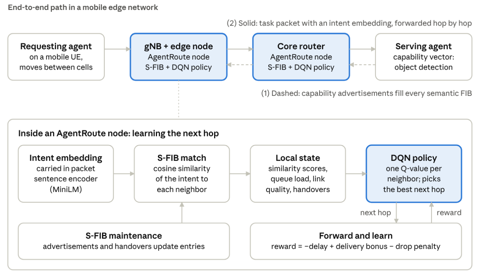{ width=92% }

*Figure 1. AgentRoute overview. Advertisements (dashed) fill the S-FIBs; a task packet with an intent embedding (solid) is forwarded hop by hop to a capable agent. Inside each node a DQN picks the next hop from the S-FIB match and the local state.*

### 3.1 Capability addresses

Every agent publishes a **capability card**: one description and two example requests, like the `examples` field of A2A agent cards.
- **Example card:** "object detection in images"; "box the vehicles in a traffic camera image"; "show where each person stands in a crowd photo".
- **Address:** each sentence is embedded with MiniLM (384 dimensions, L2-normalised). The address is the normalised mean of the sentence vectors (a prototype), together with the agent ID.
- **Why a prototype:** we measured three alternatives on unseen paraphrases (top-1 class accuracy). A short description alone reaches 0.61–0.65, the card as one text 0.68–0.69, and the prototype 0.77.
- **Acceptance rule:** an agent accepts a task when cos(intent, address) ≥ τ.
- **Choosing τ:** τ maximises F1 over all (training intent, card) pairs, with same class as positive. This gives **τ = 0.405** (precision 0.64, recall 0.54).
- **On unseen test paraphrases:** the most similar card belongs to the right class 77% of the time, and 0.6% of other-class pairs pass τ (Figure 2).

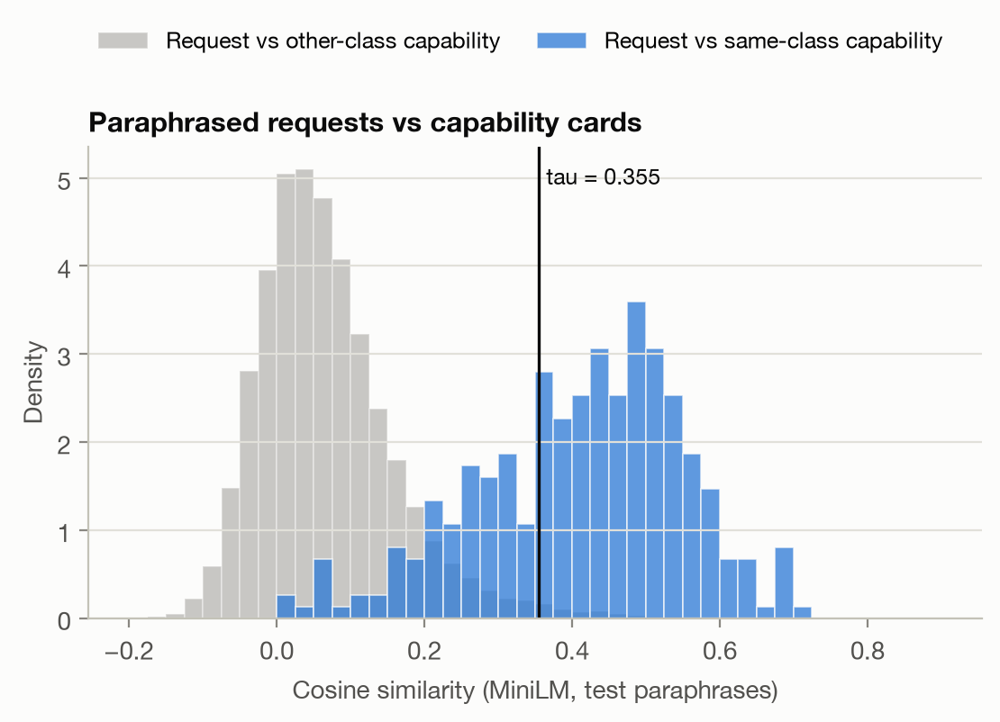{ width=72% }

*Figure 2. Cosine similarity of the 150 test paraphrases to same-class and other-class capability cards. The two distributions overlap: this overlap, not routing, limits every semantic method.*

### 3.2 Semantic FIB and bounded-radius advertisements

**What the S-FIB stores.** Router u keeps counts[n, c, d]: the number of agents with card c that are d hops away and reachable through neighbour n.

**Advertisement rule.** An agent attached to router v is learned by every router u with dist(u, v) ≤ R, through each neighbour n with dist(n, v) = dist(u, v) − 1. This is exactly what a distance-vector protocol computes when entries stop propagating after R hops; we compute it with a bounded BFS.

**Summary per neighbour.** A neighbour's advertised summary is compressed to k = 4 representatives with deterministic spherical k-means. Each representative carries the minimum hop distance of its cluster. A plain mean (k = 1) and an uncompressed table are kept for comparison. The score of a neighbour is the best cosine between the intent and its representatives.

**Control-plane cost.**
- **Soft state:** every 10 s each directed link with entries carries one refresh message, and every agent re-registers with its gNB.
- **Handover:** the old gNB withdraws and the new gNB announces, hop by hop (≈5 ms per hop) and only within R hops. A message is counted only where an advertised summary (card set or minimum distance) actually changes.
- **Failure:** neighbours notice a failed router after 1 s, and the tables are rebuilt on the remaining graph.

### 3.3 Intent-based forwarding

**Packet.** A task packet carries the intent vector, a TTL (16), the previous hop and the list of visited routers.

**At every router:**
1. **Delivery:** if an attached agent has cos ≥ τ, the best such agent gets the task.
2. **Forwarding:** otherwise the policy chooses a neighbour. The packet never goes straight back to the previous hop, unless it is a dead end.
3. **Expiry:** a packet whose TTL expires counts as failed.

The forwarding module is independent of the simulator: its input is the router's local view and the packet, its output is the next hop.

**Greedy policy (baseline).** It forwards to the unvisited neighbour with the highest S-FIB score, breaking ties by hop distance. If no neighbour has entries, it uses the default route to the core.

### 3.4 Learned next hop

**Features.** For every candidate neighbour the router builds a 14-dimensional feature vector:

| Group | Features |
|---|---|
| S-FIB match | max cosine, mean cosine, gap to the best neighbour, above-τ flag, has-entry flag, hop distance / (R+1) |
| Neighbour state | queue occupancy (from hello messages every 100 ms), in-handover flag (handover in the last 2 s) |
| Link | quality (1 − loss), delay |
| Packet | remaining TTL ratio, already-visited flag |
| Node type | core flag, cloud flag |

**Network.** One MLP (14 → 64 → 64 → 1) maps a neighbour's features to a Q-value; the packet goes to the arg-max. Because each neighbour is scored separately, one network serves all routers regardless of their degree.

**GNN variant.** It first embeds every neighbour, pools the embeddings (mean and max) into a context vector, and scores each neighbour together with this context. This is one round of message passing on the router's local star graph [10].

**Reward.**
- Each hop: −(0.05 + hop delay / 100 ms).
- Delivery to a correct agent: +1.
- Any drop (TTL, queue overflow, link loss, wrong agent, agent in handover): −1.

The scales are normalised so that neither dropping early nor wandering pays off.

**Training.**
- **Algorithm:** Double DQN, replay buffer of 50,000 transitions, batch 128, Adam (10⁻³), Huber loss, target network updated every 500 steps, γ = 0.98, ε from 1.0 to 0.05 over the first 60% of 300 episodes.
- **Bootstrap target:** the next-state value is the maximum Q over the next router's neighbours, i.e. Q-routing [6] with a neural network.
- **Episodes:** each episode is a 20 s simulation in a randomly drawn scenario: 300–2,000 agents, speed 0–20 m/s, load 0.5–4, 0–20% failed routers, R = 2–4.
- **Data split:** training uses only the 350 training paraphrases.
- **Model selection:** every 10 episodes the greedy-action policy is evaluated on fixed validation scenarios, and the weights with the best validation **return** are kept. We select by return rather than success rate because return also rewards faster delivery.
- **Deployment:** the trained weights are copied to every router.

### 3.5 Mobility

**Handover.** Mobile agents attach to the nearest gNB, with 15% hysteresis against ping-pong. A handover interrupts the agent for 50 ms and triggers the withdraw/announce updates of Section 3.2, so the rest of the network is not re-flooded.

**Mobility feature.** The DQN sees which neighbouring cells are busy with handovers.

## 4. Implementation

Everything is written in Python and runs on a laptop CPU (Apple M2):
- SimPy and NetworkX for the simulator
- PyTorch for the DQN
- sentence-transformers for MiniLM
- matplotlib for figures and animations

**Code organisation.**
- Modules follow the work packages (Section 8).
- The forwarding logic is independent of SimPy.
- All randomness is seeded from YAML configs.
- The complete source is in the code appendix (`AgentRoute_Code_Appendix.pdf`).

### 4.1 Simulator

**Topology.**
- **Cells:** gNB + edge routers on a square grid of cells, 500 m apart, with Xn links between neighbours.
- **Core:** a coarser grid of core routers (about one per 8 cells). Every gNB has a backhaul link to its nearest core router; half of them also to the second nearest.
- **Cloud:** one data centre attached to two core routers.
- **Delays:** radio 5 ms, Xn 2 ms, backhaul 5 ms, core 3 ms, cloud 20 ms.
- **Losses:** wired 0.05%, radio 0.2%; 10% of wired links are "bad" (3% loss).
- **Radio model:** fixed delay and loss in Sections 5.1 to 5.9 (`radio.model: constant`). Section 5.10 uses a distance-dependent table computed with Sionna (`radio.model: sionna`).
- **Size:** the number of cells grows with the agent count (20 agents per cell, at most 400 cells). The 10,000-agent network has 450 routers.

**Routers.**
- **Own packets:** every router is a SimPy server (0.2 ms service, queue limit 100), so registry and flooding congestion is real.
- **Background traffic:** a packet waits behind N background packets, where N follows the M/M/1 number-in-system distribution, P(N ≥ n) = ρⁿ. The wait is Gamma(N, 1 ms), and the packet is dropped if N ≥ 50.
- **Hotspots:** normal routers have ρ = 0.2. A random 15% of routers alternate between busy (ρ = 0.95) and normal with a mean period of 5 s.
- **Load:** the load factor scales ρ (capped at 0.97) together with the request rate.

**Agents.**
- **Mix:** 40% fixed edge agents, 50% random-waypoint mobile agents (speed × U[0.5, 1.5], 2 s pause), 10% cloud agents.
- **Capability supply:** follows Zipf(1) over a random ranking of the 50 classes: a few capabilities are offered by many agents, most by few.
- **Requests:** sent by edge and mobile agents at 10 requests/s, with the intent drawn uniformly from the 150 test paraphrases.

**Fairness.** Topology, mobility, traffic, network randomness and failures each use their own random stream. For a given seed every method sees the same network, the same movements and the same request sequence.

### 4.2 Baselines

- **Central registry:** one server on the most central core router (1 ms per operation, queue limit 200).
  - Agents register, refresh every 10 s and update after every handover; all of these travel over the network and load the server.
  - A request travels to the server, which returns the most similar agent (nearest copy).
  - The task then goes to that agent's last known cell, and fails with `stale_location` if the agent has moved.
- **TTL-limited flooding (TTL 6):** every router handles a request once and broadcasts it to its agents. Every agent with cos ≥ τ answers, and the requester takes the most similar answer.
- **Chord:** routers form a SHA-1 ring with finger tables, and every overlay hop is walked as a shortest path in the underlay. Agents store their card description under SHA-1 of the normalised text; requests are looked up under SHA-1 of the request text.
- **Greedy semantic forwarding:** same S-FIB as AgentRoute, fixed rule (Section 3.3).

### 4.3 Dataset

**Classes.** Fifty capability classes in six groups: vision, language, speech/audio, data/analytics, mobility/IoT/networks, other services.

**Per class:**
- two descriptions (two providers describing the same skill),
- three example requests,
- ten paraphrased requests in everyday words (350 for training, 150 for testing).

**No verbatim matches.** A unit test checks that no request repeats any card sentence and vice versa.

### 4.4 Visualisation tools

The simulator writes every event (`query`, `hop`, `deliver`, `drop`, `handover`, `adv`, `withdraw`, `move`, `load`, `fail`) to a JSONL log plus a topology snapshot. Four tools read only these files:
- `viz/plots.py`: all figures
- `viz/animate.py`: presentation videos built from real log events
- a Streamlit app that runs scenarios and replays single requests
- a React + D3 log player with timeline controls and per-request delay waterfalls

## 5. Evaluation

### 5.1 Setup

Unless stated otherwise:

| Parameter | Value |
|---|---|
| Agents | 1,000 (scalability: 100 to 10,000) |
| Mix | 40% edge, 50% mobile (5 m/s), 10% cloud |
| Advertisement radius / summary | R = 3, k-means with k = 4 |
| Requests | 10 per second, unseen test paraphrases |
| Simulated time | 30 s per run, 2 s warm-up |
| Seeds | 5 per point; figures show the mean and a 95% confidence band |

**Metrics.**
- **Discovery success:** the request reaches an agent of the right class.
- **Completion time:** request to delivery, over successful requests. For the registry it includes the query to the server, the answer and the task.
- **Hops** per delivered request.
- **Messages per request:** control plus query messages divided by the number of requests.

### 5.2 Learning curves

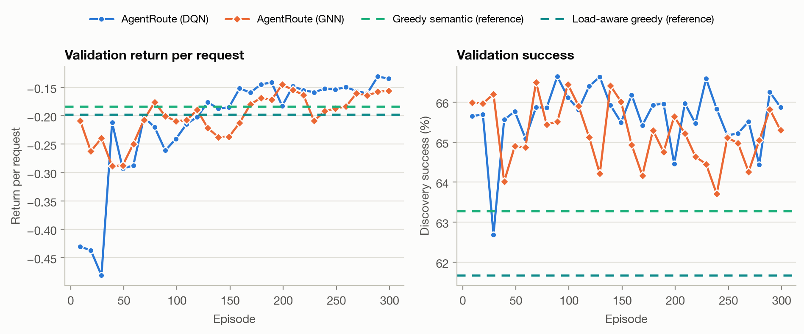

*Figure 3. Left: training return per request (smoothed). Right: success on the validation scenarios with ε = 0, every 10 episodes; dashed: greedy forwarding on the same scenarios.*

**Training behaviour.** Both policies learn quickly to reach greedy's success. After that, the validation success stays within about ±1.5 points of greedy.

**Selected models.**

| Model | Episode | Validation success | Completion time |
|---|---|---|---|
| DQN | 239 | 46.8% | 25.0 ms |
| GNN | 219 | 46.8% | 26.4 ms |
| Greedy (reference) | – | 46.7% | 28.3 ms |

**Reading.** The learned policy does not find more agents. It routes around busy routers and lossy links, which shows up as delay. Training took about 20 minutes (DQN) and 30 minutes (GNN) on the laptop CPU.

### 5.3 Scalability

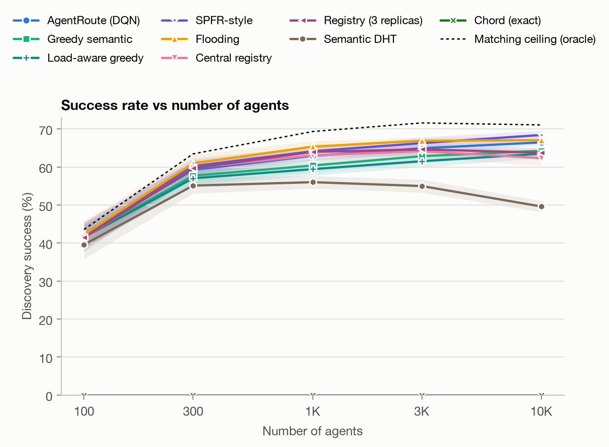{ width=80% }

*Figure 4. Discovery success from 100 to 10,000 agents.*

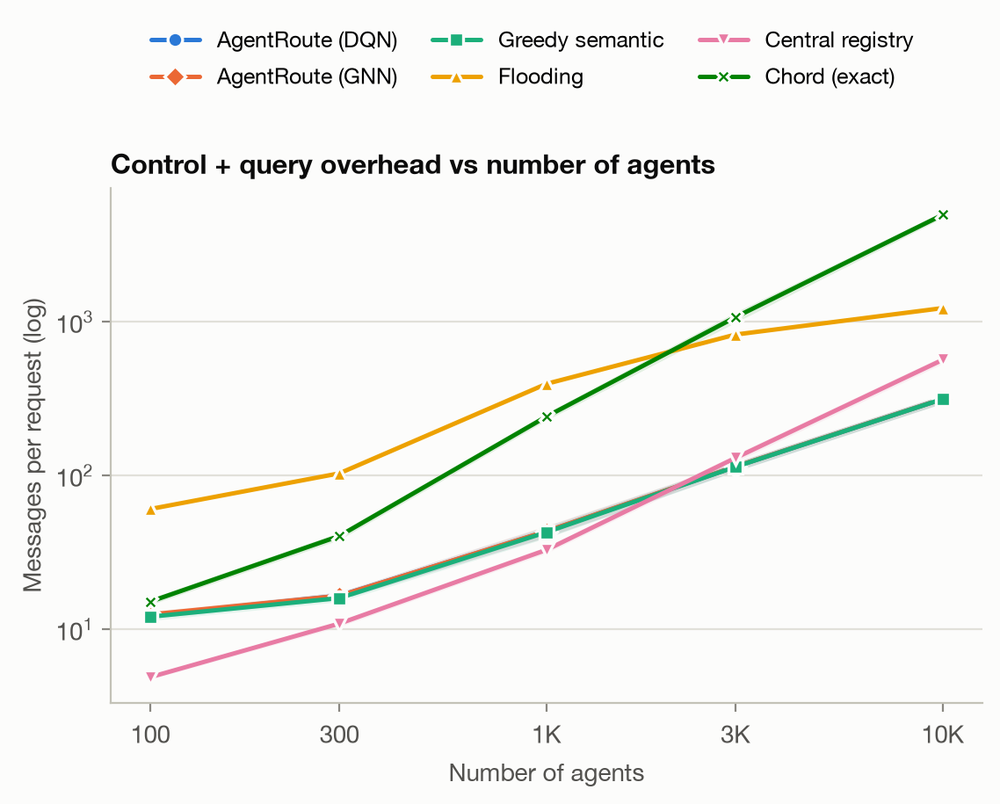{ width=80% }

*Figure 5. Messages per request (log scale): periodic control plus query traffic.*

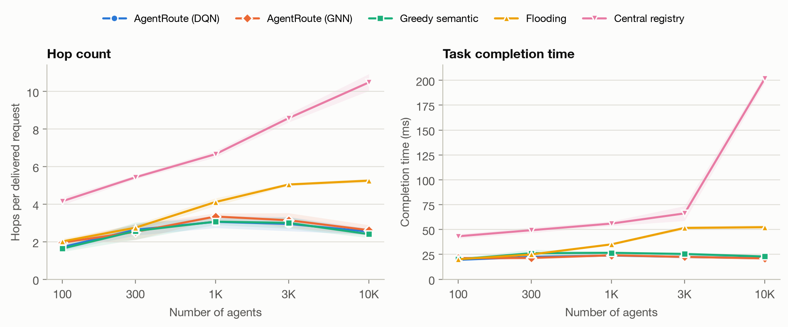

*Figure 6. Hops per delivered request and completion time.*

*Table 1. Scalability: discovery success, completion time and messages per request (mean of 5 seeds).*

| Agents | 100 | 300 | 1,000 | 3,000 | 10,000 |
|---|---|---|---|---|---|
| **Success (%)** | | | | | |
| AgentRoute (DQN) | 33.2 | 46.8 | 49.7 | 51.0 | 52.6 |
| AgentRoute (GNN) | 33.8 | 46.1 | 48.9 | 49.5 | 52.2 |
| Greedy semantic | 34.0 | 47.4 | 50.6 | 50.4 | 51.6 |
| Flooding | 36.3 | 54.5 | 60.1 | 61.3 | 61.5 |
| Central registry | 34.7 | 51.2 | 55.6 | 54.6 | 55.7 |
| Chord (exact) | 0.0 | 0.0 | 0.0 | 0.0 | 0.0 |
| **Completion time (ms)** | | | | | |
| AgentRoute (DQN) | 19.6 | 22.6 | 23.9 | 22.6 | 21.2 |
| AgentRoute (GNN) | 21.3 | 21.5 | 24.1 | 22.6 | 21.0 |
| Greedy semantic | 20.1 | 26.2 | 26.6 | 25.5 | 23.0 |
| Flooding | 20.1 | 25.0 | 35.1 | 51.6 | 52.4 |
| Central registry | 43.3 | 49.4 | 56.0 | 66.3 | 201.7 |
| **Messages per request** | | | | | |
| AgentRoute / greedy | 12 | 17 | 43 | 114 | 315 |
| Flooding | 61 | 103 | 395 | 827 | 1,230 |
| Central registry | 5 | 11 | 33 | 130 | 567 |
| Chord (exact) | 15 | 40 | 242 | 1,075 | 4,976 |


**Success.**
- With few agents every method suffers, because many requested capabilities simply do not exist in the network (Zipf supply).
- From 1,000 agents on, the ranking is stable: flooding, then the registry, then AgentRoute and greedy, with Chord at zero.
- Flooding and the registry compare *all* candidate agents and pick the best one. Hop-by-hop delivery hands the request to the *first* agent that passes τ. That agent is of the wrong class in 14–16% of the requests (Section 5.8).

**Cost.**
- Flooding pays for its higher success with 1,230 messages per request at 10,000 agents, four times AgentRoute's 315. Most of AgentRoute's messages are periodic soft-state refreshes, which do not grow with the request rate.
- The registry stays cheap in messages (567) but becomes slow: registrations alone keep its server busy, and its completion time grows from 43 ms to 202 ms.
- The DQN is the fastest method at every scale (19.6–23.9 ms). The GNN is faster than greedy, flooding and the registry from 300 agents on (21.0–24.1 ms); at 100 agents it takes 21.3 ms, against 20.1 ms for greedy and flooding.
- At 100 agents the DQN is only 2% faster than greedy. From 300 agents on it is 7–14% faster, because it avoids busy routers (Section 5.8).
- The success differences between the DQN and greedy are within seed noise: paired by seed, they range from −0.9 to +0.9 points across the five scales, with a standard deviation of about 1–2 points.

**Chord.** Chord never finds a paraphrased request. This is the reference point that shows why semantic matching is needed, not a competitor.

### 5.4 Mobility

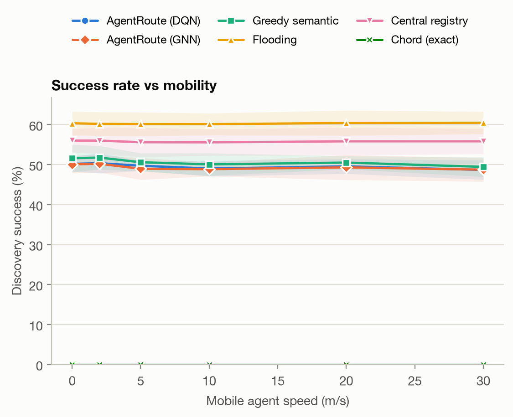{ width=80% }

*Figure 7. Success as the speed of the mobile agents grows (1,000 agents).*

**Handover rate.** At 30 m/s the 500 mobile agents perform about 1,000 handovers in 30 s.

**Effect on success.** Success is almost flat for every method: AgentRoute 50.2% → 48.7%, greedy 51.6% → 49.4%, registry 56.0% → 55.8%. Handovers interrupt an agent for only 50 ms, and the incremental S-FIB updates reach all affected routers within R × 5 ms, so stale entries live only briefly.

**Handover cost in the control plane.** One handover triggers on average 32.6, 31.6 and 24.4 S-FIB update messages at 1,000, 3,000 and 10,000 agents (`experiments/run_handover_cost.py`, 3 seeds). The cost is roughly constant because it depends only on the R-hop neighbourhood. A full advertisement round grows with the network: 444, 1,216 and 2,892 messages. At 10,000 agents a handover therefore costs 0.8% of a network-wide re-advertisement, with 47.7 handovers per second.

**Effect on time.** The completion-time advantage of AgentRoute (23–24 ms vs 26–27 ms for greedy and 55 ms for the registry) holds at every speed.

### 5.5 Node failures

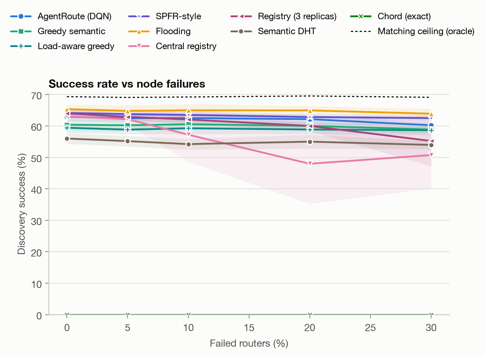{ width=80% }

*Figure 8. Success when a fraction of the routers fails at one third of each run (1,000 agents).*

**Semantic methods.** AgentRoute and greedy lose only 1–2 points even with 30% of the routers down (DQN 49.7% → 47.4%, greedy 50.6% → 49.4%). After the 1 s detection delay the S-FIBs are rebuilt on the surviving graph, and the remaining agents are still found through other neighbours.

**Flooding** is unaffected (≈60%): it does not depend on any table.

**Central registry.** The registry shows what a single point of failure means.
- The registry router is not among the failed routers in most seeds, and the registry then keeps its 55–58%.
- In the seeds where it is (two of five at 20%, one at 30%), success collapses to 14–17%.
- This pulls its mean down to 39% at 20% failures.

### 5.6 Advertisement radius

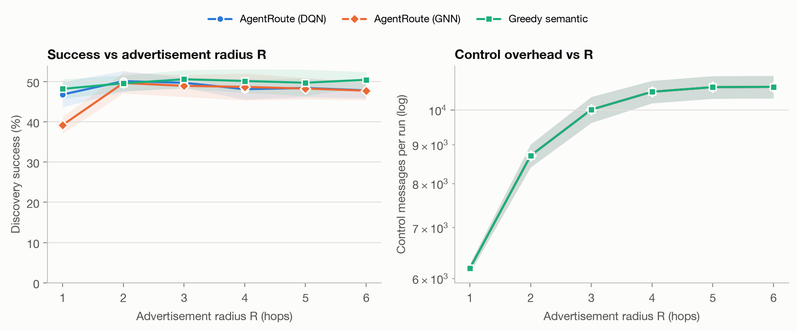

*Figure 9. Success and control messages as a function of the advertisement radius R (1,000 agents, 64 cells, 74 routers).*

**Control messages** grow from 6,190 per run at R = 1 to 10,015 at R = 3. They saturate at about 10,700 from R = 5 on, when advertisements cover almost the whole 74-router network (its diameter is 6 hops).

**Success.** R = 1 is too short for the learned policies: the DQN reaches 46.8%, and the GNN, which was trained with R = 2–4, only 39.2%. From R = 2 on, success is flat (48–51%). In this network size R = 2–3 gives almost all of the benefit for 60–80% of the maximum control traffic.

**Default.** We use R = 3 as the default, which leaves room for larger networks.

### 5.7 Network load

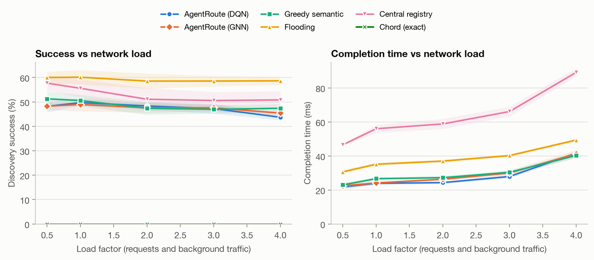

*Figure 10. Success and completion time when the load factor scales both the request rate and the background utilisation of every router (1,000 agents).*

**Registry and flooding.**
- The registry suffers first: its completion time grows from 47 ms to 89 ms and its success falls from 57.7% to 50.8%.
- Flooding keeps its success but becomes slower (31 → 49 ms).

**Learned policies.**
- Up to a load factor of 3 the DQN is as successful as greedy (47.3% vs 47.0% at load 3) and faster (27.9 vs 30.4 ms).
- At the highest load (4×) the DQN falls behind greedy by 3.7 points (43.7% vs 47.4%; GNN 45.4%), and both need about 41 ms.
- The loss comes from queue overflow, not from TTL expiry. At 4× the DQN loses 17.6% of its requests to full queues against 12.2% for greedy, while its TTL expiry is slightly lower (22.2% vs 23.9%).
- We have not analysed why the DQN overflows more queues at this load. Two possible factors, both untested: load 4 appears in only about one in five training episodes, and queue occupancy reaches the policy only through hello messages every 100 ms, so several packets may pick the same router that looks idle.
- Weighting loaded scenarios more heavily in training, or fresher queue information, are candidate fixes; we did not try them.

We report this as the main open issue of the learned policy.

### 5.8 Where failures come from

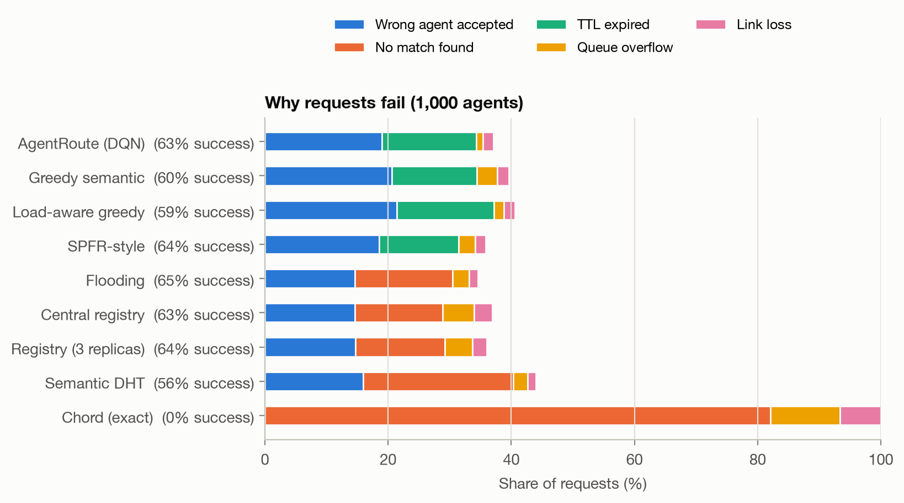{ width=85% }

*Figure 11. Why requests fail (1,000 agents, mean of 5 seeds).*

**Unmatched requests.** About 28–30% of all requests have no agent within τ anywhere in the network. This shows up as "no match found" for flooding and the registry and as TTL expiry for the hop-by-hop methods, which keep searching until their TTL runs out.

**Wrong-class acceptance.**
- In 14–15% of the requests, the first agent that passes τ on the way is of the wrong class.
- Flooding and the registry compare all candidates and lose only 10–11% this way.
- This 4–5 point gap is the price of hop-by-hop delivery to the first acceptable agent.

**Effect of learning.**

| Drop reason | Greedy | DQN |
|---|---|---|
| Queue overflow | 4.3% | 0.4% |
| TTL expiry | 28.3% | 33.0% |

The DQN almost eliminates queue overflows. In exchange, more of its packets wander until the TTL expires, so success stays level while delay improves.

### 5.9 Ablations

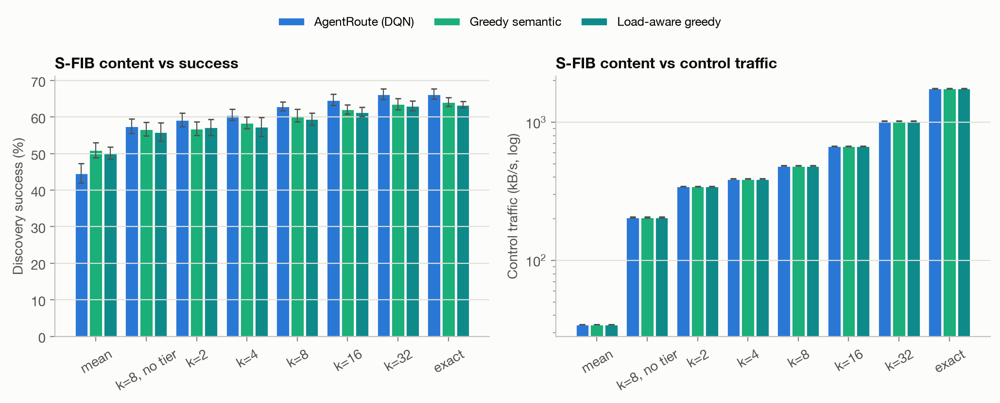{ width=70% }

*Figure 12. Success with different per-neighbour summaries (1,000 agents).*

**S-FIB summary.**

| Summary per neighbour | Greedy | DQN |
|---|---|---|
| Plain mean (k = 1) | 48.6% | 47.9% |
| k-means, k = 2 | 48.8% | 47.2% |
| k-means, k = 4 (default) | 50.6% | 49.7% |
| k-means, k = 8 | 52.4% | 50.9% |
| Uncompressed table | 55.6% | 54.7% |

- Averaging the capabilities behind a neighbour does blur them.
- The uncompressed table is 5 points better, but its size grows with the number of distinct capabilities.
- k = 4 to 8 is a reasonable middle ground.

**Intent header.**

| Encoding | Bytes | Greedy | DQN |
|---|---|---|---|
| float32 | 1,536 | 50.6% | 49.7% |
| int8 | 388 | 50.8% | 50.0% |
| binary signs | 48 | 25.1% | 25.0% |

- Quantising the intent to int8 costs nothing.
- Keeping only the signs halves the success rate.
- **Conclusion:** a 388-byte header is a practical choice.


### 5.10 Distance-dependent radio link from Sionna

Sections 5.1 to 5.9 use a fixed radio hop (5 ms delay, 0.2% loss). To test how much the results depend on this choice, we replaced it by a link model computed with NVIDIA Sionna 2.2.0 [14], an open-source library for physical-layer research. The simulator is not replaced: Sionna only produces a table (`results/radio_lut.npz`), and the simulator reads it (`radio.model: sionna`; the default `constant` reproduces all earlier results bit for bit, checked by a test).

**Chain (all steps in Sionna).**
1. TR 38.901 urban-microcell channel [15]: path loss with LoS probability, shadow fading and small-scale fading, for a UE at a given distance from a three-sector gNB.
2. Per-subcarrier SINR for the uplink (UE to gNB), then the effective SINR with EESM.
3. The calibrated 5G NR LDPC block error rate (BLER) of one fixed MCS (`sionna.sys.PHYAbstraction`).
4. HARQ: a UE keeps its LoS state and shadowing across attempts. For each distance, the table stores the probability of delivery at attempt 1 to 4 and of a drop after 4 attempts. A retransmission adds 4 ms to the 5 ms base delay.

For every distance in the grid (5 to 500 m) we simulate 2,000 independent drops with a seeded generator, so the same command rebuilds the same table.

*Table 2. Radio parameters (`configs/radio.yaml`). They are a priori choices, not tuned to the results.*

| Parameter | Value |
|---|---|
| Carrier, bandwidth, subcarrier spacing | 3.5 GHz, 20 MHz, 30 kHz (612 subcarriers) |
| UE transmit power, gNB noise figure | 23 dBm, 5 dB |
| gNB / UE height | 10 m / 1.5 m |
| gNB antenna | 38.901 sector pattern, 2 cross-polarised ports combined |
| MCS | NR table 1, index 4 (QPSK, code rate about 0.59) |
| HARQ | at most 4 attempts, 4 ms per retransmission |

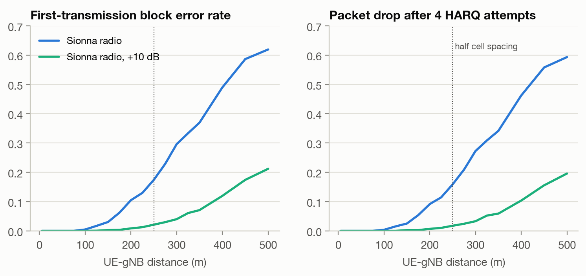

*Figure 13. First-transmission BLER and drop probability after four attempts as a function of the UE-gNB distance (blue: Table 2; green: +10 dB link budget).*

**The table.** The drop probability is below 1% up to 100 m, 16% at 250 m (half the cell spacing) and 59% at 500 m. For a UE uniformly placed in a 500 m cell (mean distance 191 m), the mean drop probability of one radio hop is 9.7%, against 0.2% in the fixed model. The +10 dB variant (for example beamforming gain, `--extra-gain-db 10`) lowers it to 1.0%.

**How the radio hops enter the simulator.**
- AgentRoute and greedy use two radio hops per delivered request: the request from the requesting UE and the last hop to the serving agent.
- The registry uses four: request, answer and task at the requester, plus the last hop to the serving agent.
- Flooding and Chord use one, because the answer of a flooding agent arrives after a constant delay and is not subject to radio loss. This favours flooding.
- Cloud agents have no radio hop.

*Table 3. Discovery success (%) with the fixed and the Sionna radio (1,000 agents, mean of 5 seeds; `results/radio_tables.md`).*

| Method | Fixed radio | Sionna radio | Sionna, +10 dB |
|---|---|---|---|
| AgentRoute (DQN) | 49.7 | 39.0 | 48.1 |
| AgentRoute (GNN) | 49.0 | 39.8 | 48.1 |
| Greedy semantic | 50.6 | 42.1 | 49.6 |
| Flooding | 60.1 | 54.0 | 59.5 |
| Central registry | 55.6 | 38.5 | 54.0 |
| Chord (exact) | 0.0 | 0.0 | 0.0 |

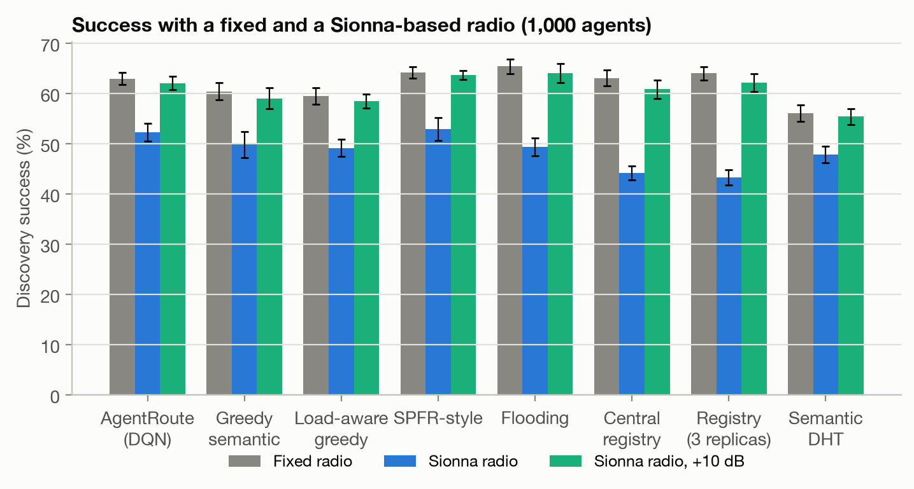{ width=85% }

*Figure 14. Discovery success with the three radio models (error bars: 95% confidence interval over 5 seeds).*

**Findings.**
- **Success falls for every method.** The loss on the radio link (`link` drops) rises from 2–3% to 17–19% of all requests for AgentRoute, 10% for flooding and 26% for the registry. These shares match the number of radio hops above and the 9.7% loss per hop.
- **The ranking changes for the registry.** It falls from 55.6% to 38.5%, because it crosses the radio four times. It is now level with the DQN (39.0%) and the GNN (39.8%) and below greedy (42.1%). Flooding stays first (54.0%), but see the note on its radio hops above.
- **The DQN loses more than greedy.** Paired by seed, the DQN is 3.1 points below greedy (standard deviation 0.7, all five seeds negative), against 0.9 points (standard deviation 1.6) with the fixed radio. The DQN was trained with the fixed radio and not retrained, and we have not analysed why it loses more radio packets (19.4% against 16.5% for greedy).
- **Completion time and hops barely change.** Times move by at most about 1 ms, since only delivered requests are counted and most are delivered at the first attempt. Flooding sends fewer messages (357 against 395 per request), because requests lost on the first radio hop are never flooded.
- **With a +10 dB link budget the results are close to the fixed radio.** The conclusions of Sections 5.1 to 5.9 therefore hold for a well-dimensioned radio, but the absolute success values depend on the link budget.
- **Mobility.** Success stays flat from 0 to 30 m/s, as with the fixed radio (DQN 40.9% to 39.2%, greedy 41.9% to 40.1%, flooding 55.3% to 55.1%; Figure 15). The distance distribution of a UE does not depend on its speed, and we do not model the Doppler shift.

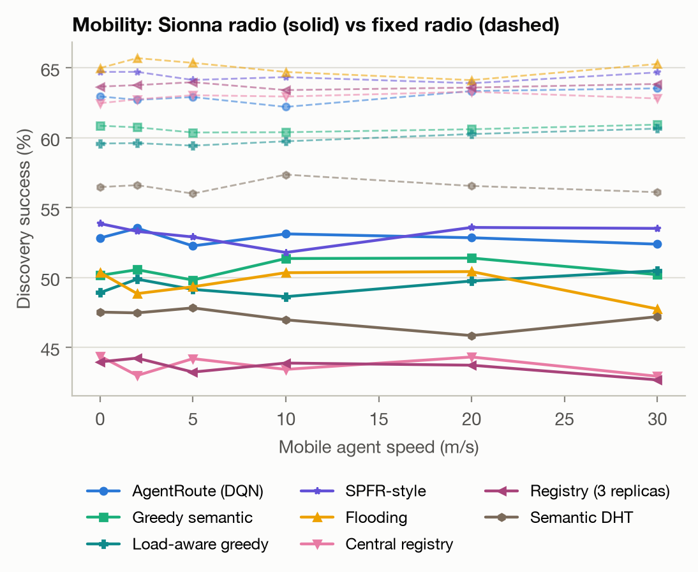{ width=70% }

*Figure 15. Success against speed with the Sionna radio (solid) and with the fixed radio (dashed).*

**Simplifications.** One MCS and no link adaptation; no interference from other cells and no scheduling delay; no beamforming; attempts are independent given the UE (no combining gain, a mildly pessimistic choice); only the uplink is computed and it is used for both directions; each gNB is one 120-degree sector; speed enters only through the position of the UE. We did not run the 100 to 10,000 agent scalability sweep with the Sionna radio.

## 6. Discussion

**Network layer or overlay?** The design lives at the network layer: addressing, a forwarding table and hop-by-hop forwarding. It could first be deployed as an overlay over UDP/IP, as IPv6 was first tunnelled over IPv4, before any router hardware changes.

**Header size.** A float32 intent costs 1,536 bytes per packet. Int8 quantisation brings it to 388 bytes at no measurable cost, while binary signs (48 bytes) halve the success rate (Section 5.9).

**Acceptance is the bottleneck.** The overlap of same-class and other-class similarities (Figure 2) limits every semantic method, including the registry with global knowledge.
- **Lower τ:** finds more agents but delivers more requests to the wrong one.
- **Better match:** a stronger or fine-tuned encoder, or agents that verify a task before accepting it, would raise success more than any routing change.
- **Not the routing:** within the matching limit, the next-hop decision mainly determines delay and losses.

**Why the DQN gains are modest.** In our scenarios most requests are served within two or three hops. The learned policy mainly avoids busy routers and lossy links. That gives consistent delay gains and a success rate within about a point of greedy, but not a large success gain. Under the heaviest load it even loses success to greedy, through more queue overflows (Section 5.7). On-device fine-tuning and richer state (e.g. per-capability load of the serving agents) are natural next steps.

**Limitations.**
- The dataset is synthetic (50 classes, written by us).
- The radio is modelled by delay and loss only in Sections 5.1 to 5.9. Section 5.10 replaces it by a distance-dependent table built with Sionna, which still lacks interference, link adaptation, beamforming and Doppler, and its absolute loss depends on the link budget we assumed.
- Background traffic is modelled analytically.
- Agents are honest: a malicious agent advertising false capabilities is out of scope. Signed advertisements or reputation are future work.

## 7. Conclusion and Future Work

AgentRoute addresses packets to capabilities and lets routers learn the next hop.

- **What the evaluation shows:** a semantic FIB with bounded-radius advertisements finds agents by meaning without a central server or flooding. It is the fastest of all methods, needs a quarter of flooding's messages and handles mobility with local updates.
- **What it does not show:** its success is limited by sentence-embedding matching, and hop-by-hop delivery to the first acceptable agent costs a few points of success against methods that compare all agents.
- **What learning adds:** the DQN learns a policy as successful as greedy forwarding and, from 300 agents on, 7–14% faster. At the default load it removes almost all queue drops, but more of its packets run out of TTL. Under the heaviest load it falls behind greedy, because more of its packets meet full queues.

**Future work.**
- Better encoders and agent-side verification
- On-device fine-tuning of the shared model
- Signed advertisements
- Retraining the DQN under the Sionna radio, link adaptation and Sionna RT ray tracing for the radio
- A UDP overlay prototype on real hosts

## 8. Team Contributions

The work followed the work packages of the proposal. Module headers in the code name the responsible member (for the Sionna radio module the responsible member is still to be assigned). `docs/KIM_NE_YAPTI.md` gives the full file-by-file list.

| Member | Responsibility | Main files |
|---|---|---|
| Ömer Faruk Gedikli | Simulator, topology, mobility model, event log, baselines | `agentroute/sim/*`, `agentroute/baselines/*`, `agentroute/config.py` |
| Bekir Emre Sarıpınar | Capability dataset, embeddings, τ tuning, S-FIB and advertisements, greedy forwarding | `agentroute/data/capabilities.py`, `embeddings.py`, `sfib.py`, `forwarding.py`, `experiments/tune_tau.py` |
| Bekir Göktepe | DQN next-hop policy, GNN variant, replay buffer, training | `agentroute/dqn/*`, `experiments/run_train.py` |
| All | Experiments, figures, tests, report, slides | `experiments/`, `viz/`, `tests/`, `docs/` |

## 9. Use of AI Tools

The core of the project was the team's work: the dataset, embeddings, S-FIB, forwarding, DQN/GNN, simulator and baselines. An AI coding assistant (Claude) was used for the supporting parts:
- the experiment scripts and the additional experiments (load, S-FIB summary and header ablations)
- the plotting code
- the presentation animations
- the Streamlit application
- the React + D3 log player
- the tooling that builds the PDFs and the slides
- the Sionna radio model (Section 5.10): the table builder `experiments/build_radio_lut.py`, `agentroute/radio/`, the `radio.model` switch in the simulator, the radio experiments and figures, and this section

These files say so in their header. All reported numbers come from runs of the code in this repository.

## References

[1] C. Fleming, L. Muscariello, V. Pandey, R. Kompella, "A Layered Protocol Architecture for the Internet of Agents," arXiv:2511.19699, 2025.

[2] Y. Qin, L. Peng, F. Tang, M. Zhao, "SPFR: Semantic Potential Field Routing for the Distributed Internet of Agents," arXiv:2608.25396, 2026.

[3] S. Guo et al., "Agent Discovery in Internet of Agents: Challenges and Solutions," arXiv:2511.19113, 2025.

[4] IETF Internet-Draft draft-wang-dmsc-drisac-00, capability registration and semantic discovery for AI agents, Aug. 2026.

[5] L. Zhang et al., "Named Data Networking," ACM SIGCOMM Computer Communication Review, 44(3), 2014.

[6] J. A. Boyan, M. L. Littman, "Packet Routing in Dynamically Changing Networks: A Reinforcement Learning Approach," NIPS, 1994.

[7] V. Mnih et al., "Human-level control through deep reinforcement learning," Nature, 518, 2015.

[8] H. van Hasselt, A. Guez, D. Silver, "Deep Reinforcement Learning with Double Q-learning," AAAI, 2016.

[9] R. Alliche, T. Da Silva Barros, R. Aparicio-Pardo, L. Sassatelli, "PRISMA: A Packet Routing Simulator for Multi-Agent Reinforcement Learning," IFIP Networking Workshops, 2022.

[10] S. S. Bhavanasi, L. Pappone, F. Esposito, "Dealing with Changes: Resilient Routing via Graph Neural Networks and Multi-Agent Deep Reinforcement Learning," IEEE TNSM (code: github.com/routing-drl/main).

[11] I. Stoica, R. Morris, D. Karger, M. F. Kaashoek, H. Balakrishnan, "Chord: A Scalable Peer-to-peer Lookup Service for Internet Applications," ACM SIGCOMM, 2001.

[12] N. Reimers, I. Gurevych, "Sentence-BERT: Sentence Embeddings using Siamese BERT-Networks," EMNLP, 2019.

[13] T. Camp, J. Boleng, V. Davies, "A Survey of Mobility Models for Ad Hoc Network Research," Wireless Communications and Mobile Computing, 2(5), 2002.

[14] J. Hoydis, S. Cammerer, F. Ait Aoudia, A. Vem, N. Binder, G. Marcus, A. Keller, "Sionna: An Open-Source Library for Next-Generation Physical Layer Research," arXiv:2203.11854, 2022 (software: github.com/NVlabs/sionna, Apache-2.0).

[15] 3GPP TR 38.901, "Study on channel model for frequencies from 0.5 to 100 GHz."

## Appendix A. Reproducing the results

```bash
uv venv --python 3.12 .venv && uv pip install --python .venv/bin/python -r requirements.txt
.venv/bin/python -m pytest -q                       # tests
.venv/bin/python experiments/run_all.py             # tau, training, all experiments, figures, demo, videos
.venv/bin/python docs/build_pdfs.py                 # this report and the code appendix as PDF

# Radio experiments (Section 5.10). The tables are in the repository; Sionna is only needed to rebuild them.
.venv/bin/python experiments/run_radio.py compare   # fixed radio vs Sionna radio
.venv/bin/python experiments/run_radio.py mobility
.venv/bin/python viz/plot_radio.py
# rebuild results/radio_lut*.npz (separate environment: pip install -r requirements-radio.txt)
python experiments/build_radio_lut.py
python experiments/build_radio_lut.py --extra-gain-db 10 --out results/radio_lut_plus10db.npz
```

The full run takes about an hour on a MacBook Air (M2): about 30 minutes of training and 20 minutes of experiments. `docs/KULLANIM_KILAVUZU.md` describes every script, the configuration keys and the log format.
