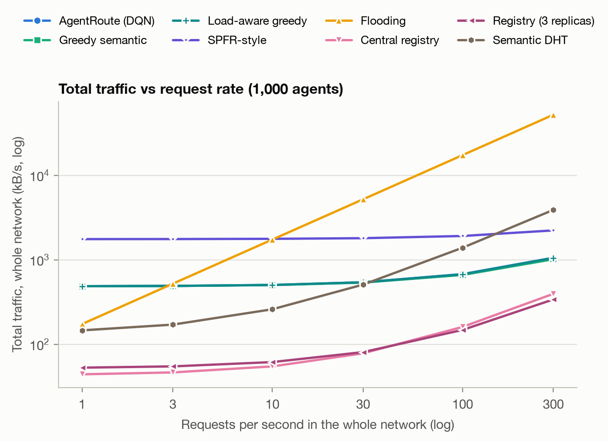
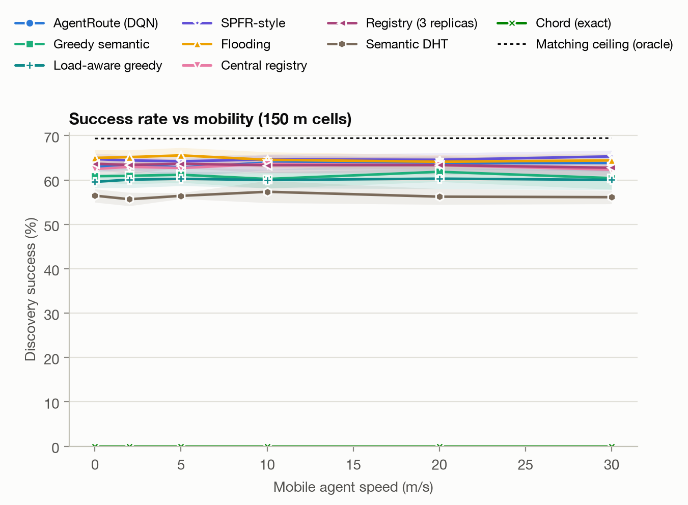
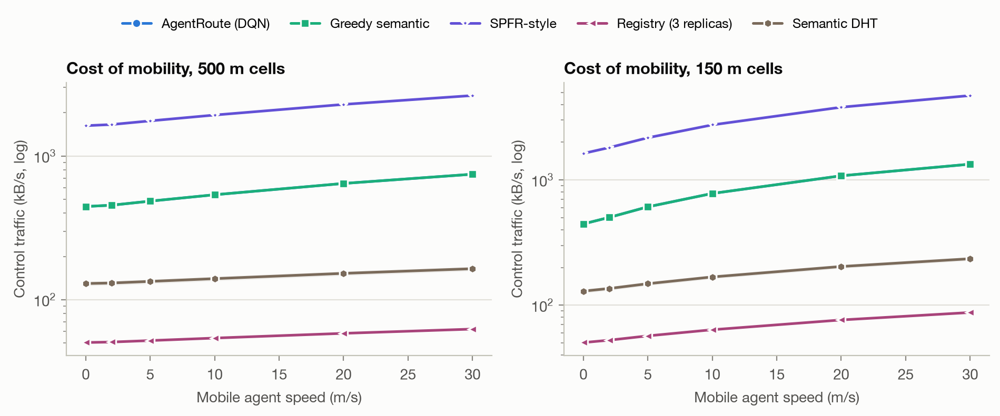
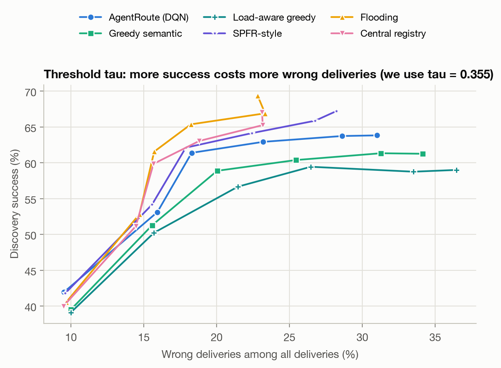
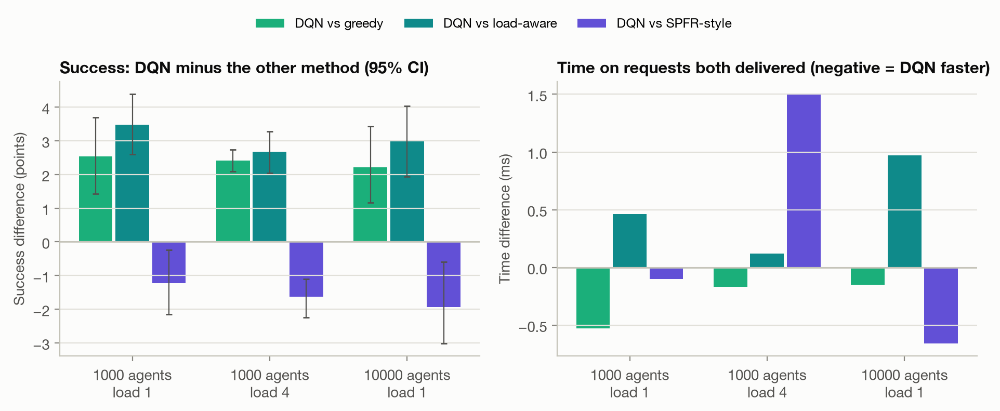

<div class="title-block" markdown="1">

# AgentRoute: Learning-Based Semantic Capability Routing for AI Agents in Mobile Networks

**CSE 476/575 Mobile Communication Networks · Term Project · Final Report**

Ömer Faruk Gedikli (220104004103) · Bekir Emre Sarıpınar (220104004039) · Bekir Göktepe (220104004018)

November 2026

</div>

## Abstract

AI agents look for each other by capability ("who can detect objects in this photo?"), not by address, and many of them run on mobile devices that keep changing cell. We present **AgentRoute**, a network-layer scheme in which a packet is addressed to a *capability* and every router decides the next hop.

- **Addresses:** every agent's address is its own sentence embedding, a random mix of the sentences that describe its skill.
- **Routing tables:** a two-tier *semantic FIB* (S-FIB) keeps one row per agent one hop away and k = 8 representative vectors for everything up to R = 2 hops. It is filled by a distance-vector protocol whose bytes we count.
- **Decision:** a Double DQN shared by all routers scores every neighbour, and the option of delivering the task here, from local state.

We evaluate the system in a SimPy simulator of a cellular/edge network from 100 to 10,000 agents, over 10 seeds, with paraphrased requests never seen in training. It is compared with nine other methods, including a replicated registry, a semantic DHT, an SPFR-style forwarder and a load-aware heuristic, and against an oracle that gives the matching ceiling.

Results at 1,000 agents:

- **Learning helps, modestly.** The DQN delivers 62.9% of the requests (matching ceiling 69.3%). That is 2.5 points more than greedy forwarding on the same table (95% CI 1.4–3.7) and 3.5 points more than the load-aware heuristic. On requests that both methods deliver, the delay differs by about 0.5 ms.
- **It does not beat everything.** An SPFR-style rule with an exact table delivers 1.2 points more (CI 0.2–2.2) with 3.6 times the control bytes. Flooding delivers 2.5 points more, but needs 234 ms and 174 kB per request. A central registry has the same success as the DQN and one eleventh of its control traffic, but takes 60 ms instead of 21 ms and is a single point of failure.
- **The matching limits everything.** Six pre-trained encoders reach only 73–77% top-1 accuracy on unseen paraphrases, and the choice of the acceptance threshold moves success far more than any routing change.
- **A realistic radio lowers every method.** With a distance-dependent radio computed with Sionna, success falls by 8 to 21 points. The registries, which cross the radio four times, fall the most, and the DQN keeps its lead over greedy (Section 5.13).

## 1. Introduction

**The problem.** Today's Internet answers *where?*: a host has an IP address, and users reach services through DNS names they already know. AI agents ask a different question: *who can do this task?*
- They search by capability, at machine speed, in large and changing populations.
- Many of them run on phones, cars or drones whose point of attachment changes with every handover.

**The two classic answers.**
- **A central registry (DNS-like):** every registration and every request passes one server, which is a bottleneck and a single point of failure.
- **Flooding:** needs no state, but its traffic grows with the size of the network.
- **Recent proposals** add agent-specific protocols above HTTP [1] or capability discovery services [3], [4].

**Our approach.** AgentRoute changes the network layer instead: the address of a destination is *what it can do*.

**Contributions.**
1. **Capability addresses with one vector per agent,** and an acceptance threshold chosen for the open-set question the network really faces.
2. **A two-tier semantic FIB** built by a distance-vector protocol on vector summaries, with every byte of advertisements, withdrawals and refreshes counted.
3. **An acceptance rule** that compares the local agent with what the S-FIB knows about remote ones.
4. **A learned decision.** One Double DQN, shared by all routers, scores each neighbour and the option of delivering here, so it handles any number of neighbours.
5. **An evaluation designed to be falsifiable:** a matching ceiling, per-second and per-request traffic reported separately, a request-rate sweep, 10 seeds, paired comparisons with confidence intervals, and baselines that are hard to beat (replicated registry, semantic DHT, SPFR-style forwarding, load-aware heuristic).

## 2. Background and Related Work

**Internet of Agents.**
- Fleming et al. [1] propose a layered protocol architecture for agents built on top of HTTP.
- Guo et al. [3] survey agent discovery and list the scalability and freshness problems of registries.
- The IETF draft on capability registration and semantic discovery [4] standardises a registry-based service.
- All three keep the network layer unchanged.

**Semantic forwarding.**
- SPFR [2] is the closest work: each executor in a local semantic forwarding table acts as a task-conditioned potential source whose influence decays with hop distance, and packets follow the dominant potential hop by hop.
- The IETF draft on a semantic routing architecture [14] also places a Semantic Forwarding Table in routers.
- Forwarding on a similarity table is therefore not new. What we study is whether *learning* the rule helps when the table is compressed, in a mobile cellular/edge setting.

**Older intent-based and content-based networks.**
- INS [15] resolves intentional names (attribute-value descriptions) in an overlay of name resolvers, which is the same goal with exact attribute matching.
- Siena [17] routes notifications by content and propagates summaries of predicates hop by hop. Our S-FIB summaries are the vector-space analogue of its covering relation.
- pSearch [16] places documents in a DHT by their semantic vectors. Our semantic DHT baseline follows the same idea.

**Information-centric networking.** Named Data Networking [5] also routes by name instead of address, but matches names exactly or by prefix. A paraphrased request ("find the cars in this photo") does not share a prefix with "object detection".

**Learned routing.**
- Q-routing [6] learns per-destination delivery times with a table, using the minimum over the next node's neighbours as the bootstrap target. Our update is the same idea with a neural network, Double DQN [8] and an experience replay buffer [7].
- Multi-agent DRL routing simulators such as PRISMA [9] and GNN-based resilient routing [10] motivated our per-neighbour scoring and the GNN variant.

**DHTs.** Chord [11] gives O(log N) exact-match lookups. We use it as the representative of exact-match discovery.

**Sentence embeddings.** We use all-MiniLM-L6-v2 from Sentence-Transformers [12].

## 3. System Design

{ width=92% }

*Figure 1. AgentRoute overview. Advertisements (dashed) fill the S-FIBs; a task packet with an intent embedding (solid) is forwarded hop by hop to a capable agent. Inside each node a DQN picks the next hop from the S-FIB match and the local state.*

### 3.1 Capability addresses

**Sentences.** Each capability class has five sentences, like the `examples` field of A2A agent cards: two provider descriptions and three example requests.

**Address of one agent.** Every sentence is embedded with MiniLM (384 dimensions, L2-normalised). Agent j draws its own weights from Dirichlet(2) and its address is the normalised weighted sum of the five vectors. Two providers of the same skill are close but never identical, so a router cannot keep one row per capability and has to summarise.

**Acceptance.** An agent can take a task when cos(intent, address) ≥ τ. We choose τ for the question the network faces, "is the best agent I can see good enough?", and score each outcome as the reward does: +1 if the best agent is right and passes τ, −1 if it is wrong and passes τ, 0 if nothing passes. A capable agent exists with probability 0.9; otherwise anything accepted is wrong. This gives **τ = 0.355**.

On the 150 unseen test paraphrases, with sampled agents of all classes:

| Measure | Value |
|---|---|
| Most similar agent has the right class | 76.0% |
| Right class and passes τ | 70.7% |
| Wrong class and passes τ | 16.7% |
| Rejected when no capable agent exists | 49.3% |

**The encoder is not the lever.** We compared six pre-trained encoders (MiniLM, multi-qa-MiniLM, mpnet, bge-small, bge-base, e5-small). Top-1 accuracy on the test paraphrases lies between 0.733 and 0.773, and with n = 150 a difference below about 7 points cannot be told apart from noise. A small trained projection head reached 0.78–0.83 on classes it had seen and 0.77–0.81 on classes held out, which is within the noise of this test set, so we did not adopt it. MiniLM stays.

{ width=72% }

*Figure 2. Cosine similarity of the 150 test paraphrases to same-class and other-class capability cards. The two distributions overlap: this overlap, not routing, limits every semantic method.*

### 3.2 Semantic FIB and bounded-radius advertisements

**Two tiers per neighbour.**
- **Rows:** one row per agent for agents attached to the neighbour itself.
- **Summaries:** at most k = 8 representative vectors for what the neighbour has learned from further away, up to R = 2 hops. Each representative carries a hop count and a weight.

**Advertisement rule.** What router u tells its neighbour w is computed from u's own agents and from what u heard from its other neighbours, compressed again with deterministic weighted spherical k-means. Only those vectors cross the link, so the size of a summary does not depend on the number of agents, and information is summarised again at every hop. This is a real distance-vector protocol on summaries, not a global computation.

**Score of a neighbour.** The best cosine between the intent and its rows and representatives.

**What the bytes are.** Every message has 40 bytes of headers; every row has 388 bytes for the int8-quantised vector and 8 bytes for hop and weight. Experiments report bytes per second, not message counts, because messages of different sizes are not comparable.

**Control-plane events.**
- **Soft state:** every 10 s all summaries are recomputed from the true state and re-sent, and every agent re-registers with its gNB.
- **Handover:** the old gNB withdraws the agent and the new gNB announces it. The agent's vector travels hop by hop within R, and a router forwards it only if it moved one of its representatives by more than 0.01. Smaller changes wait for the refresh.
- **Failure:** neighbours notice a failed router after 1 s, and the tables are rebuilt on the remaining graph.

### 3.3 Intent-based forwarding and acceptance

**Packet.** A task packet carries the intent vector (int8, 388 bytes), a TTL (16), the previous hop and the list of visited routers.

**At every router:**
1. **Candidate:** find the best attached agent with cos ≥ τ.
2. **Acceptance (best known):** deliver to it only if no unvisited neighbour advertises something better after attenuating that candidate by exp(−ω·hops), with ω = 0.08 (the value used by SPFR).
3. **Forwarding:** otherwise the policy chooses a neighbour. The packet never goes straight back to the previous hop, unless it is a dead end.
4. **Expiry:** a packet whose TTL runs out is delivered if a local agent passes τ, and fails otherwise.

The forwarding module is independent of the simulator: its input is the router's local view and the packet, its output is a local agent or a next hop.

**Heuristic policies on the same table.**
- **Greedy:** the unvisited neighbour with the highest S-FIB score, ties broken by hop distance. If no neighbour has entries, the default route to the core.
- **Load-aware greedy:** among the neighbours within 0.05 of the best score, the least loaded one. This is the hand-written competitor of the DQN.

### 3.4 Learned decision

**Actions.** Every neighbour, plus LOCAL ("deliver here") when a local agent passes τ. The DQN therefore decides both whether to stop and where to go.

**Features.** For every action the router builds a 15-dimensional feature vector:

| Group | Features |
|---|---|
| S-FIB match | max cosine, mean cosine, gap to the best action, above-τ flag, has-entry flag, hop distance / (R+1) |
| Neighbour state | queue occupancy (from hello messages every 100 ms), in-handover flag (handover in the last 2 s) |
| Link | quality (1 − loss), delay |
| Packet | remaining TTL ratio, already-visited flag |
| Action type | core flag, cloud flag, local flag |

**Network.** One MLP (15 → 64 → 64 → 1) maps an action's features to a Q-value and the router takes the arg-max. Because each action is scored separately, one network serves all routers regardless of their degree.

**GNN variant.** It first embeds every action, pools the embeddings (mean and max) into a context vector, and scores each action together with this context. This is one round of message passing on the router's local star graph [10].

**Reward.**
- Each decision: −(0.05 + delay / 100 ms).
- Delivery to a correct agent: +1.
- Any failure (TTL, queue overflow, link loss, wrong agent, agent in handover): −1.

All policies accumulate the same return, so the heuristics can be compared with the DQN on the DQN's own objective.

**Training.**
- **Algorithm:** Double DQN, replay buffer of 50,000 transitions, batch 128, Adam (10⁻³), Huber loss, target network updated every 500 steps, γ = 0.98, ε from 1.0 to 0.05 over the first 60% of 300 episodes.
- **Bootstrap target:** the maximum Q over the next router's actions, i.e. Q-routing [6] with a neural network.
- **Episodes:** each episode is a 20 s simulation in a randomly drawn scenario: 300–2,000 agents, speed 0–20 m/s, load 0.5–4, 0–20% failed routers, R = 2–4.
- **Data split:** training and model selection use only the 350 training paraphrases. All results in Section 5 use the 150 test paraphrases on other seeds.
- **Model selection:** every 10 episodes the policy (ε = 0) is evaluated on fixed validation scenarios, and the weights with the best validation **return** are kept.
- **Deployment:** the trained weights are copied to every router.

### 3.5 Mobility

Mobile agents attach to the nearest gNB, with 15% hysteresis against ping-pong. A handover interrupts the agent for 50 ms and triggers the withdraw and announce updates of Section 3.2, so the rest of the network is not re-flooded. The DQN also sees which neighbouring cells are busy with handovers.

## 4. Implementation

Everything is written in Python and runs on a laptop CPU (Apple M2): SimPy and NetworkX for the simulator, PyTorch for the DQN, sentence-transformers for MiniLM, matplotlib for figures and animations.

**Code organisation.** Modules follow the work packages (Section 8). The forwarding logic is independent of SimPy. All randomness is seeded from YAML configs. The complete source is in the code appendix, which follows this report in the single file `AgentRoute_Final_Report_Complete.pdf` (also available as `AgentRoute_Code_Appendix.pdf`).

### 4.1 Simulator

**Topology.**
- **Cells:** gNB + edge routers on a square grid of cells, 500 m apart, with Xn links between neighbours.
- **Core:** a coarser grid of core routers (about one per 8 cells). Every gNB has a backhaul link to its nearest core router; half of them also to the second nearest.
- **Cloud:** one data centre attached to two core routers.
- **Delays:** radio 5 ms, Xn 2 ms, backhaul 5 ms, core 3 ms, cloud 20 ms.
- **Losses:** wired 0.05%, radio 0.2%; 10% of wired links are "bad" (3% loss).
- **Radio model:** fixed delay and loss in Sections 5.1 to 5.12 (`radio.model: constant`). Section 5.13 uses a distance-dependent table computed with Sionna (`radio.model: sionna`).
- **Size:** the number of cells grows with the agent count (20 agents per cell, at most 400 cells). The 1,000-agent network has 74 routers and the 10,000-agent network 450.

**Routers.**
- **Own packets:** every router is a SimPy server (0.2 ms service, queue limit 100), so registry and flooding congestion is real.
- **Background traffic:** a packet waits behind N background packets, where N follows the M/M/1 number-in-system distribution, P(N ≥ n) = ρⁿ. The wait is Gamma(N, 1 ms), and the packet is dropped if N ≥ 50.
- **Hotspots:** normal routers have ρ = 0.2. A random 15% of routers alternate between busy (ρ = 0.95) and normal with a mean period of 5 s.
- **Load:** the load factor scales ρ (capped at 0.97) together with the request rate.

**Agents.**
- **Mix:** 40% fixed edge agents, 50% random-waypoint mobile agents (speed × U[0.5, 1.5], 2 s pause), 10% cloud agents.
- **Capability supply:** follows Zipf(1) over a random ranking of the 50 classes.
- **Requests:** sent by edge and mobile agents at 10 requests/s, with the intent drawn uniformly from the 150 test paraphrases.

**Fairness.** Topology, mobility, traffic, network randomness and failures each use their own random stream. For a given seed every method sees the same network, the same movements and the same request sequence, which is what makes the paired comparisons of Section 5.11 possible.

### 4.2 Baselines

- **Greedy and load-aware greedy:** same S-FIB as AgentRoute, fixed rules (Section 3.3).
- **SPFR-style forwarding:** our re-implementation of the rule in [2], with an exact table for R = 2. Every visible executor is a source with potential φ = similarity · exp(−ω·hops), gated by τ. The packet goes one hop towards the dominant executor, and is executed locally if that executor is attached here. Executor load and price are not modelled in our simulator, so the utility is the similarity. With no visible executor the packet takes the default route.
- **Central registry:** one server on the most central core router, queue limit 200, with 1 ms per lookup (a vector search) and 0.05 ms per registration or heartbeat (a table write). Registrations, refreshes every 10 s and post-handover updates travel over the network. A request travels to the server, which returns the most similar agent; the task then goes to that agent's last known cell and fails with `stale_location` if the agent has moved.
- **Registry with 3 replicas:** a request goes to the nearest live replica, and every update is synchronised to the others, which costs bytes.
- **TTL-limited flooding (TTL 6):** every router handles a request once and broadcasts it to its agents. Every agent with cos ≥ τ answers, each answer travels back through the network, the requester collects answers for a 200 ms window, takes the most similar one and sends the task to it.
- **Chord:** routers form a SHA-1 ring with finger tables, and every overlay hop is walked as a shortest path in the underlay. Requests are looked up under SHA-1 of the request text.
- **Semantic DHT:** an inverted index on top of the same Chord ring, with a public catalogue of 64 k-means buckets. An agent registers under its closest bucket and a request looks up its two closest buckets.

**Assumptions that decide the comparison.** These are choices, and we state them because they change the result:
- **Chord's 0% is by construction,** because a paraphrase never hashes to the same key as a description. It is a reference that shows why semantic matching is needed, not a competitor.
- **Flooding's delay is its waiting window.** Section 5.12 shows the trade-off for windows from 20 ms to 1 s.
- **The registry's speed depends on the cost of a registration.** With 0.05 ms per update a single server copes with 10,000 agents. If updates cost as much as lookups the same server saturates.
- **SPFR-style is our own implementation,** without the executor load and price terms of the original.

### 4.3 Dataset

**Classes.** Fifty capability classes in six groups: vision, language, speech/audio, data/analytics, mobility/IoT/networks, other services.

**Per class:** two descriptions, three example requests, and ten paraphrased requests in everyday words (350 for training, 150 for testing).

**No verbatim matches.** A unit test checks that no request repeats any capability sentence and vice versa.

### 4.4 Visualisation tools

The simulator writes every event (`query`, `hop`, `deliver`, `drop`, `handover`, `adv`, `withdraw`, `move`, `load`, `fail`) to a JSONL log plus a topology snapshot. Four tools read only these files: `viz/plots.py` for the figures, `viz/animate.py` for the presentation videos, a Streamlit app that runs scenarios, and a React + D3 log player.

## 5. Evaluation

### 5.1 Setup

Unless stated otherwise:

| Parameter | Value |
|---|---|
| Agents | 1,000 (scalability: 100 to 10,000) |
| Mix | 40% edge, 50% mobile (5 m/s), 10% cloud |
| S-FIB | R = 2, one row per agent at one hop, k = 8 beyond |
| Requests | 10 per second, unseen test paraphrases |
| Simulated time | 30 s per run, 2 s warm-up |
| Seeds | 10 per point; figures show the mean and a 95% confidence band |

**Metrics.**
- **Discovery success:** the request reaches an agent of the right class.
- **Matching ceiling (oracle):** the share of requests whose globally most similar agent is correct and passes τ. It is a reference line rather than a strict upper bound, since a router may stop at a correct agent when the global best is wrong (some correct agent passes τ for 77.7% of the requests).
- **Precision:** correct deliveries over all deliveries.
- **Completion time:** request to delivery, over successful requests. Comparisons between two methods use requests delivered by both (Section 5.11).
- **Control traffic (kB/s):** advertisements, withdrawals, registrations and refreshes, paid per second.
- **Query traffic (kB per request):** lookups, floods, answers and forwarding, paid per request.

### 5.2 Learning curves


*Figure 3. Validation return per request and validation success with ε = 0, every 10 episodes. Dashed lines: greedy and load-aware greedy on the same scenarios and the same reward.*

| Model | Episode | Validation success | Completion time | Return per request |
|---|---|---|---|---|
| DQN | 289 | 66.3% | 22.7 ms | −0.131 |
| GNN | 199 | 65.6% | 22.9 ms | −0.145 |
| Greedy (reference) | – | 63.3% | 22.5 ms | −0.183 |
| Load-aware greedy (reference) | – | 61.7% | 20.6 ms | −0.197 |

**Reading.**
- The return improves from −0.43 at the first evaluation to −0.13 and passes both heuristics after about 150 episodes.
- Validation success is noisy and flat within about ±1.5 points after the first evaluations. The return is what shows learning: the policy keeps its deliveries and spends less to get them.
- These are validation numbers on training paraphrases. The verdict is in Sections 5.3 and 5.11, on test paraphrases and other seeds.

### 5.3 Scalability

{ width=80% }

*Figure 4. Discovery success from 100 to 10,000 agents, with the matching ceiling.*


*Figure 5. Traffic split by who pays it: control traffic per second and query traffic per request (log scales).*


*Figure 6. Hops per delivered request and completion time.*

*Table 1. Scalability (mean of 10 seeds).*

| Agents | 100 | 300 | 1,000 | 3,000 | 10,000 |
|---|---|---|---|---|---|
| **Success (%)** | | | | | |
| Matching ceiling | 43.6 | 63.4 | 69.3 | 71.6 | 71.1 |
| AgentRoute (DQN) | 42.1 | 59.2 | 62.9 | 64.9 | 66.5 |
| AgentRoute (GNN) | 42.8 | 59.0 | 63.8 | 65.3 | 66.9 |
| Greedy semantic | 41.7 | 57.7 | 60.4 | 62.8 | 64.3 |
| Load-aware greedy | 41.5 | 57.0 | 59.4 | 61.5 | 63.5 |
| SPFR-style | 42.2 | 60.2 | 64.1 | 66.3 | 68.4 |
| Flooding | 42.2 | 61.0 | 65.4 | 66.9 | 67.1 |
| Central registry | 41.3 | 59.8 | 63.0 | 64.2 | 62.3 |
| Registry, 3 replicas | 41.5 | 59.7 | 64.0 | 64.6 | 63.8 |
| Semantic DHT | 39.6 | 55.1 | 56.0 | 55.0 | 49.6 |
| Chord (exact) | 0.0 | 0.0 | 0.0 | 0.0 | 0.0 |
| **Completion time (ms)** | | | | | |
| AgentRoute (DQN) | 19.0 | 19.7 | 20.6 | 20.1 | 18.0 |
| AgentRoute (GNN) | 20.2 | 21.2 | 21.5 | 20.8 | 18.6 |
| Greedy semantic | 18.1 | 19.4 | 20.7 | 20.0 | 17.9 |
| Load-aware greedy | 17.2 | 18.2 | 19.5 | 18.2 | 16.5 |
| SPFR-style | 17.4 | 19.3 | 21.0 | 20.0 | 19.0 |
| Flooding | 224.4 | 226.7 | 233.9 | 239.4 | 239.9 |
| Central registry | 44.6 | 50.7 | 59.9 | 71.4 | 82.8 |
| Registry, 3 replicas | 43.7 | 46.8 | 57.5 | 65.1 | 74.3 |
| Semantic DHT | 65.1 | 76.7 | 130.5 | 188.9 | 253.5 |
| **Control traffic (kB/s)** | | | | | |
| AgentRoute and greedy | 51 | 124 | 485 | 1,442 | 4,372 |
| SPFR-style | 96 | 351 | 1,757 | 5,497 | 20,632 |
| Flooding | 0 | 0 | 0 | 0 | 0 |
| Central registry | 3 | 10 | 43 | 195 | 887 |
| Registry, 3 replicas | 4 | 11 | 52 | 262 | 1,242 |
| Semantic DHT | 5 | 19 | 134 | 637 | 2,847 |
| **Query traffic (kB per request)** | | | | | |
| AgentRoute (DQN) | 3.0 | 2.0 | 1.9 | 1.7 | 1.6 |
| Greedy semantic | 2.8 | 1.8 | 1.7 | 1.6 | 1.4 |
| SPFR-style | 2.7 | 1.8 | 1.5 | 1.4 | 1.3 |
| Flooding | 26.1 | 45.0 | 173.7 | 369.9 | 545.8 |
| Central registry | 0.7 | 1.0 | 1.2 | 1.7 | 2.2 |
| Registry, 3 replicas | 0.6 | 0.6 | 1.0 | 1.4 | 1.8 |
| Semantic DHT | 4.7 | 6.2 | 12.6 | 18.9 | 24.0 |

**Success.**
- Every method grows with the number of agents because more capabilities exist in the network, and the ceiling grows with them.
- At 1,000 agents methods with full knowledge lead: flooding 65.4%, SPFR-style 64.1%, three replicas 64.0%, GNN 63.8%, registry 63.0%, DQN 62.9%. Paired against the DQN, the registry is level (−0.1 points, CI −1.1 to 1.0), and three replicas and flooding are ahead (by 1.1 and 2.5 points).
- At 10,000 agents the routed methods catch up: DQN 66.5%, flooding 67.1% (the difference is not significant), and the DQN is ahead of the registry by 4.2 points (CI 2.2–6.4). The round trip to the server crosses about 12 hops at that size, so 12.4% of the registry's requests are lost to queues and links, against 2.5% for the DQN.
- The semantic DHT falls with size, because a fixed catalogue separates a growing population poorly (28.7% of its requests find nothing at 10,000 agents).

**Time.** The hop-by-hop methods need about 17–22 ms at every size and differ by a millisecond or two. The registry grows from 45 to 83 ms and the semantic DHT from 65 to 254 ms. Flooding's time is its waiting window.

**Traffic.** The two columns of Figure 5 cannot be added without a request rate, which is why we show them separately.
- AgentRoute pays 485 kB/s of control traffic at 1,000 agents, 11 times the registry's 43 kB/s. Its tables are expensive.
- Per router this is 6.6 kB/s at 74 routers and 9.7 kB/s at 450 routers, so it grows slowly. The 10,000-agent network also has more agents per cell, because the number of cells is capped at 400.
- Its query cost is 1.9 kB per request, against 174 kB for flooding.

### 5.4 Traffic against request rate

{ width=75% }

*Figure 7. Total traffic of the whole network as the request rate grows (1,000 agents).*

Combining both components gives the answer that depends on how busy the network is:
- **Against flooding:** AgentRoute costs less above about 2.8 requests per second. At 300 requests per second flooding needs about 52,000 kB/s and AgentRoute about 1,000 kB/s.
- **Against SPFR-style:** the exact table needs 3.6 times the control bytes, and flooding stays cheaper than it up to about 10 requests per second.
- **Against the semantic DHT:** AgentRoute costs less above about 30 requests per second.
- **Against the registry:** AgentRoute is **never** cheaper, at any request rate we tried. The case for it against a registry is delay and the absence of a single server, not traffic.

### 5.5 Mobility

{ width=80% }

*Figure 8. Success as the speed of the mobile agents grows (1,000 agents, 500 m cells).*

{ width=80% }

*Figure 9. The same experiment with 150 m cells, where handovers are much more frequent.*



*Figure 10. Control traffic against speed. The DQN uses the same tables as greedy, so its line is hidden.*

**Success does not depend on speed.** Between 0 and 30 m/s every method stays within about one point of its value: DQN 63.0% → 63.5%, greedy 60.9% → 60.9%, registry 62.5% → 62.8%. This holds with 150 m cells too (DQN 63.0% → 63.8%). A handover interrupts an agent for only 50 ms and updates reach the affected routers within R × 5 ms, so stale entries live briefly.

**Mobility is paid for in traffic.** With 150 m cells at 30 m/s AgentRoute's control traffic grows from 445 to 1,336 kB/s, against 50 to 87 kB/s for three registry replicas.

*Table 2. Handover cost in the control plane.*

| Agents | Routers | Handovers/s | Messages per handover | Handover kB/s | Refresh kB/s |
|---|---|---|---|---|---|
| 1,000 | 74 | 4.5 | 20.4 | 40 | 327 |
| 3,000 | 195 | 14.0 | 20.3 | 124 | 963 |
| 10,000 | 450 | 47.7 | 20.4 | 423 | 2,866 |

The cost per handover is constant because only the R-hop neighbourhood is involved, and the periodic refresh, not mobility, dominates the bill.

**Caveat.** Our mobility model does not stress discovery. A task that lasts through several handovers, or realistic handover failures, would be needed to separate the methods.

### 5.6 Node failures

{ width=80% }

*Figure 11. Success when a fraction of the routers fails at one third of each run (1,000 agents).*

**Distributed methods** lose little even with 30% of the routers down: DQN 62.9% → 60.2%, GNN 63.8% → 61.3%, greedy 60.4% → 58.9%, SPFR-style 64.1% → 62.5%, flooding 65.4% → 63.9%.

**The registry must be read conditionally.** Its mean depends on whether the server happened to be among the failed routers, which is a coin flip per seed, and that explains the wide band in the figure.

*Table 3. Central registry and 3-replica registry under failures (mean success; n = seeds out of 10).*

| Failed routers | Registry, server up | Registry, server down | 3 replicas, at least one up | 3 replicas, all down |
|---|---|---|---|---|
| 10% | 61.6% (n = 9) | 17.9% (n = 1) | 62.1% (n = 10) | – |
| 20% | 60.7% (n = 7) | 18.4% (n = 3) | 60.0% (n = 10) | – |
| 30% | 58.8% (n = 8) | 18.4% (n = 2) | 59.3% (n = 9) | 18.8% (n = 1) |

The roughly 18% in the "down" columns are the requests served before the failure at one third of the run. A registry without replicas is a real single point of failure, and three replicas remove almost all of the problem for 21% more control traffic at 1,000 agents and 40% at 10,000. This is a fair argument against our own motivation: replication is cheap.

### 5.7 Advertisement radius


*Figure 12. Success and control traffic as a function of the advertisement radius R (1,000 agents).*

*Table 4. Effect of the radius.*

| R | 1 | 2 | 3 | 4 | 5 | 6 |
|---|---|---|---|---|---|---|
| Control traffic (kB/s) | 279 | 485 | 487 | 493 | 500 | 506 |
| DQN success (%) | 56.7 | 62.9 | 63.3 | 62.8 | 63.4 | 62.4 |
| Greedy success (%) | 55.8 | 60.4 | 59.8 | 59.0 | 58.4 | 58.4 |
| DQN completion time (ms) | 53.9 | 20.6 | 21.4 | 21.5 | 21.9 | 22.0 |

- R = 2 is enough. Beyond it nothing improves and greedy gets slightly worse, because re-summarised far-away information competes with accurate local rows.
- Control traffic is flat above R = 2, because a link carries at most k representatives whatever the radius. This is the benefit of re-summarising at every hop.
- **R = 1 is out of the DQN's training range** (R = 2–4). There its completion time jumps to 54 ms and its hop count to 6.4, while the GNN stays at 21 ms. A policy does not transfer automatically to a table it has not seen.

### 5.8 Network load


*Figure 13. Success and completion time when the load factor scales both the request rate and the background utilisation of every router (1,000 agents).*

*Table 5. Success (%) under load.*

| Load | 0.5 | 1 | 2 | 3 | 4 |
|---|---|---|---|---|---|
| AgentRoute (DQN) | 63.2 | 62.9 | 62.0 | 61.5 | 61.0 |
| AgentRoute (GNN) | 63.9 | 63.8 | 63.0 | 62.1 | 61.3 |
| Greedy semantic | 61.3 | 60.4 | 59.3 | 58.5 | 58.6 |
| Load-aware greedy | 60.4 | 59.4 | 58.9 | 58.3 | 58.3 |
| SPFR-style | 65.6 | 64.1 | 62.7 | 62.1 | 62.6 |
| Flooding | 68.0 | 65.4 | 61.8 | 61.9 | 61.7 |
| Central registry | 66.0 | 63.0 | 57.6 | 57.4 | 56.9 |
| Registry, 3 replicas | 66.3 | 64.0 | 57.9 | 57.6 | 57.8 |
| Semantic DHT | 65.7 | 56.0 | 45.0 | 43.5 | 43.7 |

- The methods with a server or a large flood lose the most: registry −9 points, semantic DHT −22, flooding −6. The hop-by-hop methods lose 2–3 points.
- At the highest load the DQN is at 61.0%, level with flooding (61.7%) and ahead of greedy by 2.4 points (CI 2.1–2.7). Completion times of the hop-by-hop methods all rise to 30–32 ms, against 96 ms for the registry and 251 ms for flooding.
- The hand-written load-aware rule is not better than plain greedy in success at any load (−0.9 points, CI −1.7 to −0.15 at load 1). It is about 1 ms faster. Simply steering around queues does not find more agents.

### 5.9 The threshold τ

{ width=75% }

*Figure 14. Success against the share of wrong deliveries as τ varies from 0.25 to 0.5.*

*Table 6. Success (%) and precision against τ.*

| τ | 0.25 | 0.30 | 0.355 | 0.40 | 0.45 | 0.50 |
|---|---|---|---|---|---|---|
| DQN success | 63.8 | 63.7 | 62.9 | 61.4 | 53.1 | 41.9 |
| DQN precision | 0.690 | 0.714 | 0.768 | 0.817 | 0.841 | 0.905 |
| Greedy success | 61.3 | 61.3 | 60.4 | 58.9 | 51.3 | 39.5 |
| SPFR-style success | 67.2 | 65.9 | 64.1 | 62.1 | 54.1 | 41.8 |
| Flooding success | 69.4 | 66.9 | 65.4 | 61.6 | 52.8 | 40.6 |
| Registry success | 67.1 | 65.2 | 63.0 | 59.9 | 51.2 | 40.0 |

Moving τ from 0.355 to 0.5 costs 21 points of success, far more than the difference between any two methods. It buys precision (0.77 → 0.91). Which point is right depends on the cost of a wrong delivery, so τ is a deployment decision and not a constant of the protocol. The DQN was trained at τ = 0.355, and at low τ it falls behind flooding by more, as wrong deliveries rise to about 31%.

### 5.10 Where failures come from

{ width=85% }

*Figure 15. Why requests fail (1,000 agents, mean of 10 seeds).*

*Table 7. Outcome of requests (% of all requests, 1,000 agents).*

| | DQN | Greedy | SPFR-style | Flooding | Registry |
|---|---|---|---|---|---|
| Delivered to a right agent | 62.9 | 60.4 | 64.1 | 65.4 | 63.0 |
| Wrong agent accepted | 19.0 | 20.6 | 18.5 | 14.6 | 14.6 |
| TTL expired / no match found | 15.3 | 13.8 | 12.9 | 15.9 | 14.2 |
| Queue overflow | 1.1 | 3.4 | 2.7 | 2.7 | 5.1 |
| Link loss | 1.7 | 1.9 | 1.7 | 1.4 | 3.0 |

**Reading.**
- **No match.** For about 14–16% of all requests flooding and the registry report that nothing passes τ. Hop-by-hop methods discover this only when their TTL runs out.
- **Wrong agent.** The remaining gap to flooding is here: 19.0% against 14.6%. Flooding and the registry compare all agents; the S-FIB has only summaries.
- **Where the DQN's 2.5 points come from** (against greedy): 2.3 fewer points of queue overflow and 1.6 of wrong deliveries, minus 1.5 more of TTL expiry.

### 5.11 Paired comparisons

Every method sees the same requests, so we compare per request and per seed. The confidence interval is a bootstrap over the 10 seeds.



*Figure 16. Left: difference in success. Right: difference in completion time, computed only over requests that both methods delivered.*

*Table 8. Paired comparisons. Time is the mean over requests delivered by both.*

| Scenario | Pair | Success difference (points, 95% CI) | Time (ms) |
|---|---|---|---|
| 1,000 agents, load 1 | DQN − greedy | +2.54 (1.42, 3.69) | 19.7 vs 20.3 |
| | DQN − load-aware | +3.48 (2.60, 4.38) | 19.8 vs 19.3 |
| | DQN − SPFR-style | −1.22 (−2.16, −0.24) | 20.3 vs 20.4 |
| | GNN − DQN | +0.91 (0.08, 1.70) | 20.8 vs 20.3 |
| 1,000 agents, load 4 | DQN − greedy | +2.42 (2.09, 2.73) | 29.5 vs 29.7 |
| | DQN − load-aware | +2.67 (2.04, 3.27) | 29.3 vs 29.2 |
| | DQN − SPFR-style | −1.63 (−2.25, −1.10) | 30.5 vs 29.0 |
| | GNN − DQN | +0.33 (−0.20, 0.84) | 30.8 vs 30.3 |
| 10,000 agents, load 1 | DQN − greedy | +2.21 (1.16, 3.43) | 17.4 vs 17.6 |
| | DQN − load-aware | +2.99 (1.94, 4.03) | 17.3 vs 16.3 |
| | DQN − SPFR-style | −1.94 (−3.02, −0.60) | 17.7 vs 18.4 |
| | GNN − DQN | +0.43 (−0.45, 1.25) | 18.1 vs 17.7 |

**Reading.**
- The DQN beats both heuristics on the same table in all three scenarios, and the intervals exclude zero.
- It loses to SPFR-style forwarding in all three, but SPFR-style has a different table. Given the same exact table, the DQN delivers **2.2 points more** than the SPFR-style rule (CI 1.4–2.9, 66.3% vs 64.1%) and is 5 ms slower. Greedy on the exact table equals SPFR-style in success.
- **Time on matched requests is not a win for anyone.** Against greedy the DQN saves 0.2–0.5 ms, and against the load-aware rule it is up to 1 ms slower. The learning effect is on success.
- The GNN's advantage over the MLP is small and significant in only one of three scenarios.

### 5.12 Ablations


*Figure 17. Success and control traffic with different S-FIB contents (1,000 agents).*

*Table 9. What the table holds.*

| S-FIB content | Control (kB/s) | Greedy (%) | DQN (%) |
|---|---|---|---|
| One mean vector per neighbour | 34 | 51.0 | 44.6 |
| k = 8, no per-agent rows | 205 | 56.7 | 57.5 |
| k = 2 | 344 | 56.8 | 59.2 |
| k = 4 | 390 | 58.4 | 60.6 |
| **k = 8 (default)** | 485 | 60.4 | 62.9 |
| k = 16 | 672 | 62.1 | 64.7 |
| k = 32 | 1,020 | 63.6 | 66.2 |
| Exact | 1,757 | 64.1 | 66.3 |

Averaging capabilities does blur them (51% for greedy). Per-agent rows for the first hop are worth 3.7 points for greedy and 5.4 for the DQN, at 280 kB/s. Each doubling of k above 8 buys 1.5–2 points of success for 40–50% more traffic. The DQN does badly on mean vectors because it was never trained on them.

*Table 10. Intent header.*

| Encoding | Bytes | Query kB per request (DQN) | Greedy (%) | DQN (%) |
|---|---|---|---|---|
| float32 | 1,536 | 6.9 | 60.8 | 62.7 |
| **int8 (default)** | 388 | 1.9 | 60.4 | 62.9 |
| binary signs | 48 | 0.7 | 49.7 | 51.1 |

Int8 quantisation costs nothing. Binary signs lose about 11 points.

**Acceptance rule.** Taking the first agent that passes τ, greedy reaches 56.3% with precision 0.698. The best-known rule gives 60.4% with precision 0.746, for the same control traffic.

**Change threshold in handover messages.** Raising it from 0 to 0.2 lowers control traffic from 529 to 475 kB/s with no measurable change in success (60.2–60.5%).

*Table 11. Flooding's waiting window.*

| Window | 20 ms | 50 ms | 100 ms | 200 ms | 500 ms | 1 s |
|---|---|---|---|---|---|---|
| Success (%) | 35.9 | 63.4 | 65.8 | 65.4 | 65.3 | 64.7 |
| Time (ms) | 38 | 79 | 134 | 234 | 534 | 1,034 |

A 200 ms window is generous. With 50 ms flooding loses two points and needs 79 ms. Below that, answers do not arrive in time. "Flooding is ten times slower" is therefore a statement about this parameter; the honest version is "flooding needs at least about 80 ms to get close to its best".

### 5.13 Distance-dependent radio link from Sionna

Sections 5.1 to 5.12 use a fixed radio hop (5 ms delay, 0.2% loss). To test how much the results depend on this choice, we replaced it by a link model computed with NVIDIA Sionna 2.2.0 [18], an open-source library for physical-layer research. The simulator is not replaced: Sionna only produces a table (`results/radio_lut.npz`), and the simulator reads it (`radio.model: sionna`; the default `constant` reproduces the results of Sections 5.1 to 5.12 bit for bit: a test checks all ten methods at 100 agents, and the fixed-radio column of Table 13 is identical to the 5 m/s point of Section 5.5 for every method and seed).

**Chain (all steps in Sionna).**
1. TR 38.901 urban-microcell channel [19]: path loss with LoS probability, shadow fading and small-scale fading, for a UE at a given distance from a three-sector gNB.
2. Per-subcarrier SINR for the uplink (UE to gNB), then the effective SINR with EESM.
3. The calibrated 5G NR LDPC block error rate (BLER) of one fixed MCS (`sionna.sys.PHYAbstraction`).
4. HARQ: a UE keeps its LoS state and shadowing across attempts. For each distance, the table stores the probability of delivery at attempt 1 to 4 and of a drop after 4 attempts. A retransmission adds 4 ms to the 5 ms base delay.

For every distance in the grid (5 to 500 m) we simulate 2,000 independent drops with a seeded generator, so the same command rebuilds the same table.

*Table 12. Radio parameters (`configs/radio.yaml`). They are a priori choices, not tuned to the results.*

| Parameter | Value |
|---|---|
| Carrier, bandwidth, subcarrier spacing | 3.5 GHz, 20 MHz, 30 kHz (612 subcarriers) |
| UE transmit power, gNB noise figure | 23 dBm, 5 dB |
| gNB / UE height | 10 m / 1.5 m |
| gNB antenna | 38.901 sector pattern, 2 cross-polarised ports combined |
| MCS | NR table 1, index 4 (QPSK, code rate about 0.59) |
| HARQ | at most 4 attempts, 4 ms per retransmission |


*Figure 18. First-transmission BLER and drop probability after four attempts as a function of the UE-gNB distance (blue: Table 12; green: +10 dB link budget).*

**The table.** The drop probability is below 1% up to 100 m, 16% at 250 m (half the cell spacing) and 59% at 500 m. For a UE uniformly placed in a 500 m cell (mean distance 191 m), the mean drop probability of one radio hop is 9.7%, against 0.2% in the fixed model. The +10 dB variant (for example beamforming gain, `--extra-gain-db 10`) lowers it to 1.0%.

**How the radio hops enter the simulator.**
- AgentRoute, the GNN, greedy, load-aware greedy and the SPFR-style rule use two radio hops per delivered request: the request from the requesting UE and the last hop to the serving agent.
- The semantic DHT and Chord also use two: the lookup runs between routers, so no answer crosses the radio.
- The registry and its three replicas use four: request, answer and task at the requester, plus the last hop to the serving agent.
- Flooding uses five on the path of a delivered request: the request, the answer (agent to its router, router to the requester), the task and the last hop. A lost answer does not end the request if another agent also answered.
- Cloud agents have no radio hop.

*Table 13. Discovery success (%) with the fixed and the Sionna radio (1,000 agents, mean of 10 seeds; `results/radio_tables.md`).*

| Method | Fixed radio | Sionna radio | Sionna, +10 dB |
|---|---|---|---|
| AgentRoute (DQN) | 62.9 | 52.3 | 62.0 |
| AgentRoute (GNN) | 63.8 | 52.5 | 63.0 |
| Greedy semantic | 60.4 | 49.8 | 59.0 |
| Load-aware greedy | 59.4 | 49.2 | 58.5 |
| SPFR-style | 64.1 | 52.9 | 63.6 |
| Flooding | 65.4 | 49.3 | 64.0 |
| Central registry | 63.0 | 44.2 | 60.8 |
| Registry, 3 replicas | 64.0 | 43.2 | 62.1 |
| Semantic DHT | 56.0 | 47.8 | 55.4 |
| Chord (exact) | 0.0 | 0.0 | 0.0 |

{ width=85% }

*Figure 19. Discovery success with the three radio models (error bars: 95% confidence interval over 10 seeds).*

**Findings.**
- **Success falls by 8 to 21 points for every method that finds agents.** The loss on the radio link (`link` drops) rises from 1–3% of all requests to about 18% for the hop-by-hop methods, 16% for the semantic DHT, 23% for flooding and 28–29% for the registries. These shares follow the number of radio hops above and the 9.7% loss per hop.
- **The ranking changes.** With the fixed radio, flooding (65.4%) and the registries (63–64%) are level with or above the DQN (62.9%). With the Sionna radio the SPFR-style rule (52.9%), the GNN (52.5%) and the DQN (52.3%) lead. Flooding (49.3%) is level with greedy (49.8%). The central registry falls from 63.0% to 44.2% and three replicas from 64.0% to 43.2%, because replication does not remove any radio hop. Paired by seed, the DQN is 8.1 points above the central registry (95% CI ±1.9) and 2.9 above flooding (±1.9).
- **The gain from learning survives.** Paired by seed, the DQN is 2.4 points above greedy (95% CI ±1.5; fixed radio 2.5 ± 1.2) and 3.1 above load-aware greedy (±1.7; fixed radio 3.5 ± 1.0). Against the SPFR-style rule the difference is −0.6 points (±2.0), within noise. The DQN was trained with the fixed radio and not retrained.
- **Completion time and hops barely change.** Mean times move by at most 0.4 ms, since only delivered requests are counted and most are delivered at the first attempt. Flooding sends fewer messages (413 against 463 per request), because requests lost on the first radio hop are never flooded.
- **With a +10 dB link budget the results are close to the fixed radio** (0.5 to 2.2 points lower). The conclusions of Sections 5.1 to 5.12 therefore hold for a well-dimensioned radio, but the absolute success values depend on the link budget.
- **Mobility.** Success stays flat from 0 to 30 m/s, as with the fixed radio (DQN 52.8% to 52.4%, greedy 50.2% to 50.2%, flooding 50.4% to 47.8%; Figure 20). No method moves by more than 2.7 points across speeds and none shows a consistent trend. The distance distribution of a UE does not depend on its speed, and we do not model the Doppler shift.

{ width=70% }

*Figure 20. Success against speed with the Sionna radio (solid) and with the fixed radio (dashed).*

**Simplifications.** One MCS and no link adaptation; no interference from other cells and no scheduling delay; no beamforming; attempts are independent given the UE (no combining gain, a mildly pessimistic choice); only the uplink is computed and it is used for both directions; each gNB is one 120-degree sector; speed enters only through the position of the UE. We did not run the 100 to 10,000 agent scalability sweep with the Sionna radio.

## 6. Discussion

**Network layer or overlay?** The design lives at the network layer: addressing, a forwarding table and hop-by-hop forwarding. It could first be deployed as an overlay over UDP/IP, as IPv6 was first tunnelled over IPv4, before any router hardware changes.

**Is learning worth it?** On the same table it adds 2–3.5 points of success over the heuristics we tried, in every scenario, at no additional control traffic. What it cannot do is replace information: an exact table gives more than learning does. The defensible reading is that a learned policy on a compressed table comes within about 1–2 points of an exact-table rule for about a quarter of the control bytes.

**The matching is the limit.** Better routing can close the gap to the ceiling, about 6 points at 1,000 agents; the 30 points above the ceiling belong to the encoder, the dataset and τ. Replacing the encoder did not help. Agent-side verification of a task before accepting it, or a dataset and encoder tuned together, are the likely levers.

**Do we need routing at all?** At 1,000 agents and 10 requests per second a central registry finds as many agents as the DQN, with a ninth of its total traffic, and three replicas remove its single point of failure. AgentRoute's case rests on delay (21 ms against 60 ms), on success at large scale (+4.2 points at 10,000 agents) and on having no server to operate. A reviewer who values traffic above all would choose the registry, and our data supports that choice.

**Limitations.**
- The dataset is synthetic (50 classes, written by us), and the test set has only 150 paraphrases.
- The radio is modelled by delay and loss only in Sections 5.1 to 5.12. Section 5.13 replaces it by a distance-dependent table built with Sionna, which still lacks interference, link adaptation, beamforming and Doppler, and its absolute loss depends on the link budget we assumed.
- Background traffic is modelled analytically.
- Mobility does not stress discovery in our model (Section 5.5).
- The SPFR-style baseline is our re-implementation, without its load and price terms.
- Policies were trained and evaluated in the same simulator, and do not transfer automatically to tables outside the training range (Sections 5.7 and 5.12).
- Agents are honest: a malicious agent advertising false capabilities is out of scope.

## 7. Conclusion and Future Work

AgentRoute addresses packets to capabilities and lets routers learn the decision to stop or forward.

- **What the evaluation shows:** a compressed semantic FIB with bounded-radius advertisements finds agents by meaning without a central server or flooding, with stable per-router control traffic, 18–21 ms completion times and little sensitivity to mobility and failures.
- **What learning adds:** 2–3.5 points of success over heuristics on the same table, significant in all scenarios tested. It does not improve delay on matched requests.
- **What it does not show:** that this beats everything. Exact tables, flooding and sometimes a replicated registry find more agents, and a registry is always cheaper in bytes. The largest losses come from matching, not routing.

**Future work.**
- Agent-side verification and matching tuned to capability descriptions
- Mobility models with long-running tasks and handover failures
- Training on a wider range of table designs, and on-device fine-tuning
- Signed advertisements
- Retraining the DQN under the Sionna radio, link adaptation and Sionna RT ray tracing for the radio
- A UDP overlay prototype on real hosts

## 8. Team Contributions

Module headers in the code name the responsible member (Bekir Emre Sarıpınar is responsible for the Sionna radio module). `docs/KIM_NE_YAPTI.md` gives the full file-by-file list.

| Member | Responsibility | Main files |
|---|---|---|
| Ömer Faruk Gedikli | Simulator, topology, mobility model, event log, baselines | `agentroute/sim/*`, `agentroute/baselines/*`, `agentroute/config.py` |
| Bekir Emre Sarıpınar | Capability dataset, embeddings, τ tuning, S-FIB and advertisements, greedy forwarding | `agentroute/data/capabilities.py`, `embeddings.py`, `sfib.py`, `forwarding.py`, `experiments/tune_tau.py` |
| Bekir Göktepe | DQN policy, GNN variant, replay buffer, training | `agentroute/dqn/*`, `experiments/run_train.py` |
| All | Experiments, figures, tests, report, slides | `experiments/`, `viz/`, `tests/`, `docs/` |

## 9. Use of AI Tools

The first version of the core (dataset, embeddings, S-FIB, forwarding, DQN/GNN, simulator and baselines) was the team's work. An AI coding assistant (Claude) was used for the supporting parts of that version: experiment scripts, plotting code, animations, the Streamlit application, the React + D3 log player and the tooling that builds the PDFs and slides.

The Sionna radio model (Section 5.13) was also written with the AI assistant: the table builder `experiments/build_radio_lut.py`, `agentroute/radio/`, the `radio.model` switch in the simulator, the radio experiments and figures, and that section.

After a critical review of that version, **the v2 revision described in this report was also written with the AI assistant, including the core modules**:
- `agentroute/sfib.py`, `forwarding.py`, `embeddings.py`, `sim/simulator.py`, `baselines/*`
- `agentroute/dqn/policy.py`, `train.py`, `model.py`
- `experiments/tune_tau.py`, `compare_encoders.py`, `compare_projection.py`, `run_rate.py`, `run_tau.py`, `run_matched.py`
- the tests, the figures and the text of this report

These files say so in their header, and `docs/KIM_NE_YAPTI.md` lists what changed. All reported numbers come from runs of the code in this repository.

## References

[1] C. Fleming, L. Muscariello, V. Pandey, R. Kompella, "A Layered Protocol Architecture for the Internet of Agents," arXiv:2511.19699, 2025.

[2] Y. Qin, L. Peng, F. Tang, M. Zhao, "SPFR: Semantic Potential Field Routing for the Distributed Internet of Agents," arXiv:2608.25396, 2026.

[3] S. Guo et al., "Agent Discovery in Internet of Agents: Challenges and Solutions," arXiv:2511.19113, 2025.

[4] IETF Internet-Draft draft-wang-dmsc-drisac-00, capability registration and semantic discovery for AI agents, Aug. 2026.

[5] L. Zhang et al., "Named Data Networking," ACM SIGCOMM Computer Communication Review, 44(3), 2014.

[6] J. A. Boyan, M. L. Littman, "Packet Routing in Dynamically Changing Networks: A Reinforcement Learning Approach," NIPS, 1994.

[7] V. Mnih et al., "Human-level control through deep reinforcement learning," Nature, 518, 2015.

[8] H. van Hasselt, A. Guez, D. Silver, "Deep Reinforcement Learning with Double Q-learning," AAAI, 2016.

[9] R. Alliche, T. Da Silva Barros, R. Aparicio-Pardo, L. Sassatelli, "PRISMA: A Packet Routing Simulator for Multi-Agent Reinforcement Learning," IFIP Networking Workshops, 2022.

[10] S. S. Bhavanasi, L. Pappone, F. Esposito, "Dealing with Changes: Resilient Routing via Graph Neural Networks and Multi-Agent Deep Reinforcement Learning," IEEE TNSM (code: github.com/routing-drl/main).

[11] I. Stoica, R. Morris, D. Karger, M. F. Kaashoek, H. Balakrishnan, "Chord: A Scalable Peer-to-peer Lookup Service for Internet Applications," ACM SIGCOMM, 2001.

[12] N. Reimers, I. Gurevych, "Sentence-BERT: Sentence Embeddings using Siamese BERT-Networks," EMNLP, 2019.

[13] T. Camp, J. Boleng, V. Davies, "A Survey of Mobility Models for Ad Hoc Network Research," Wireless Communications and Mobile Computing, 2(5), 2002.

[14] IETF Internet-Draft draft-li-semantic-routing-architecture-00, semantic routing architecture with a Semantic Forwarding Table, Nov. 2025.

[15] W. Adjie-Winoto, E. Schwartz, H. Balakrishnan, J. Lilley, "The Design and Implementation of an Intentional Naming System," ACM SOSP, 1999.

[16] C. Tang, Z. Xu, S. Dwarkadas, "Peer-to-Peer Information Retrieval Using Self-Organizing Semantic Overlay Networks," ACM SIGCOMM, 2003.

[17] A. Carzaniga, D. S. Rosenblum, A. L. Wolf, "Design and Evaluation of a Wide-Area Event Notification Service," ACM Transactions on Computer Systems, 19(3), 2001.

[18] J. Hoydis, S. Cammerer, F. Ait Aoudia, A. Vem, N. Binder, G. Marcus, A. Keller, "Sionna: An Open-Source Library for Next-Generation Physical Layer Research," arXiv:2203.11854, 2022 (software: github.com/NVlabs/sionna, Apache-2.0).

[19] 3GPP TR 38.901, "Study on channel model for frequencies from 0.5 to 100 GHz."

## Appendix A. Reproducing the results

```bash
uv venv --python 3.12 .venv && uv pip install --python .venv/bin/python -r requirements.txt
.venv/bin/python -m pytest -q                       # tests
.venv/bin/python experiments/run_all.py             # tau, training, all experiments, figures, demo, videos
.venv/bin/python docs/build_pdfs.py                 # this report, the code appendix, and both in one PDF

# Radio experiments (Section 5.13). The tables are in the repository; Sionna is only needed to rebuild them.
.venv/bin/python experiments/run_radio.py compare   # fixed radio vs Sionna radio
.venv/bin/python experiments/run_radio.py mobility
.venv/bin/python viz/plot_radio.py
# rebuild results/radio_lut*.npz (separate environment: pip install -r requirements-radio.txt)
python experiments/build_radio_lut.py
python experiments/build_radio_lut.py --extra-gain-db 10 --out results/radio_lut_plus10db.npz
```

The full run takes about two hours on a MacBook Air (M2): about 45 minutes of training and an hour of experiments with seven workers. `docs/KULLANIM_KILAVUZU.md` describes every script, the configuration keys and the log format.
